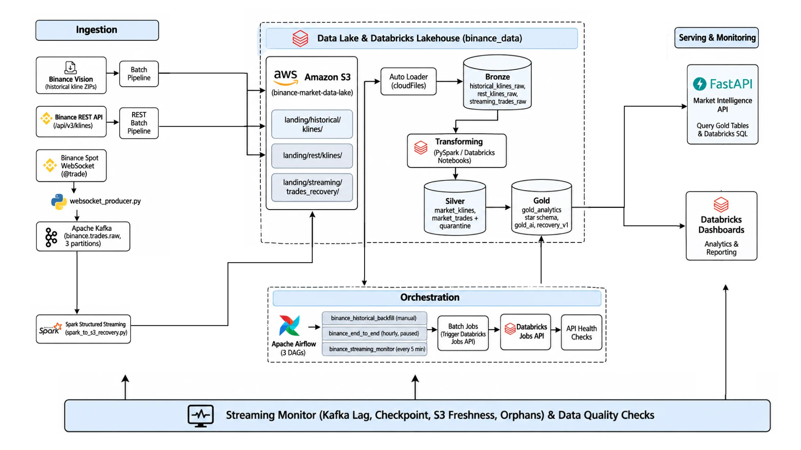
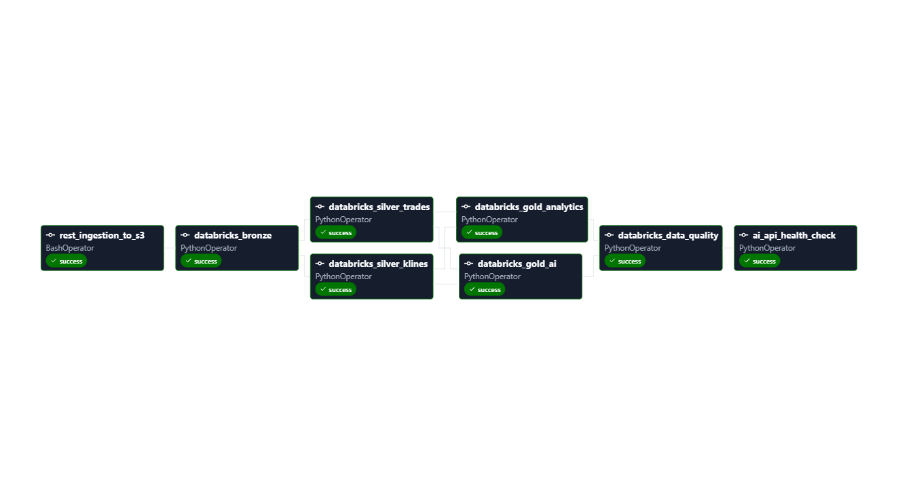
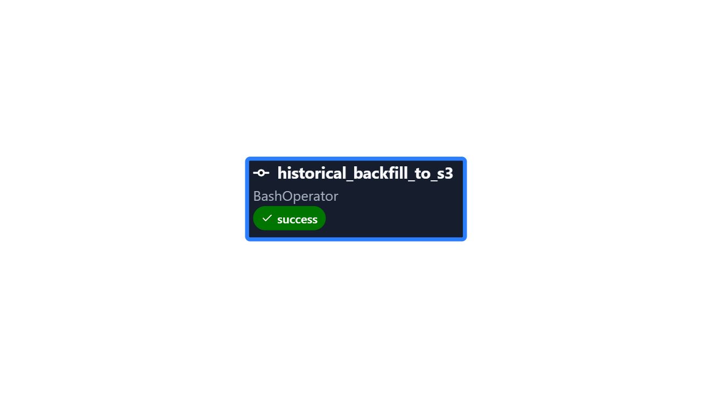
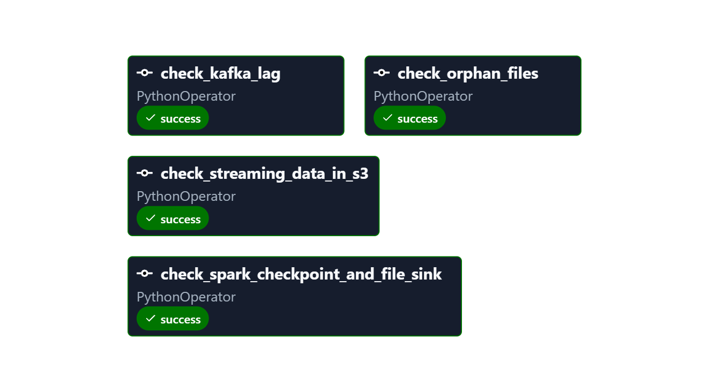

# Binance Market Data Pipeline


End-to-end data platform for public Binance spot market data. It ingests historical, REST, and real-time WebSocket data into AWS S3, builds a Delta Lake medallion architecture in Databricks, orchestrates and monitors the workflow with Airflow, and exposes curated Gold datasets through a FastAPI market intelligence service.

> Last reviewed: 2026-11-21

---

## Table of contents

- [What this project does](#what-this-project-does)
- [Architecture at a glance](#architecture-at-a-glance)
- [Tech stack](#tech-stack)
- [Repository map](#repository-map)
- [Data flow and datasets](#data-flow-and-datasets)
- [Orchestration](#orchestration)
- [Getting started](#getting-started)
- [Configuration](#configuration)
- [Documentation index](#documentation-index)
- [Screenshots](#screenshots)
- [Current operational notes](#current-operational-notes)
- [Validation commands](#validation-commands)
- [Maintenance notes](#maintenance-notes)

---

## What this project does

This repository covers the full lifecycle of Binance market data:

| Capability | Description |
|---|---|
| **Multi-mode ingestion** | Historical Binance Vision ZIP archives, Binance REST klines, and real-time WebSocket trades |
| **S3 data lake** | Raw and partitioned Parquet landing zones plus audit, checkpoint, quarantine, and metadata prefixes |
| **Streaming pipeline** | WebSocket producer → Kafka topic → Spark Structured Streaming → S3 with checkpoint/file-sink recovery support |
| **Medallion lakehouse** | Databricks Bronze (raw), Silver (validated/deduped), Gold (analytics and AI feature tables) |
| **Orchestration** | Airflow DAGs for manual historical backfill, hourly end-to-end processing, and 5-minute streaming health checks |
| **Serving layer** | FastAPI endpoints that query Databricks Gold tables through Databricks SQL |
| **Operational runbooks** | Checkpoint backup/restore, orphan-file policy, cutover guidance, and deployment setup docs |

The pipeline currently targets three symbols: `BTCUSDT`, `ETHUSDT`, and `SOLUSDT`, at a `1m` interval.

---

## Architecture at a glance



*Figure: End-to-end architecture diagram stored in `docs/screenshots/architecture_diagram/`.*

For viewers who prefer a text-rendered diagram, GitHub also renders Mermaid:

| Layer | Components | Responsibility |
|---|---|---|
| Sources | Binance Vision, REST API, WebSocket | Provide historical, near-real-time, and real-time market data |
| Ingest | Python batch jobs, `websocket_producer.py`, Spark Streaming | Validate, normalize, convert to Parquet, publish to S3 |
| Store | AWS S3 | Durable landing zone, checkpoints, audits, quarantine, and metadata |
| Transform | Databricks Auto Loader, Delta Lake, Unity Catalog | Bronze raw tables, Silver business tables, Gold analytics/AI tables |
| Orchestrate | Airflow | Trigger batch/Databricks jobs and monitor streaming health |
| Serve | FastAPI + Databricks SQL | Expose market intelligence endpoints over Gold tables |

---

## Tech stack

| Area | Technology | Where it is used |
|---|---|---|
| Language | Python 3.11+ | Ingestion, streaming producer, tests, API |
| Batch processing | PySpark 3.5.6 | Local Spark utilities and streaming consumer |
| Messaging | Apache Kafka 4.1.0 | `binance.trades.raw` topic, 3 partitions |
| Object storage | AWS S3 + boto3 / S3A | Parquet landing, checkpoints, audits, quarantine |
| Lakehouse | Databricks, Delta Lake, Unity Catalog | `binance_data` catalog and medallion schemas |
| Incremental ingestion | Databricks Auto Loader (`cloudFiles`) | S3 → Bronze with schema evolution and checkpoints |
| Orchestration | Apache Airflow 3.3.2, LocalExecutor, PostgreSQL | DAG scheduling and Databricks Jobs API calls |
| Serving | FastAPI, Uvicorn, `databricks-sql-connector` | Market intelligence REST API |
| Containers | Docker Compose | Kafka, Spark, Airflow, and API services |
| Testing | pytest | Unit/integration tests under `tests/` and `src/` |

---

## Repository map

```text
.
├── src/
│   ├── api/            # Binance REST client
│   ├── historical/     # Vision archive planning, download, validation, Parquet, S3 publish
│   ├── pipeline/       # REST kline ingestion orchestration
│   ├── streaming/      # WebSocket producer and Spark → S3 streaming jobs
│   ├── storage/        # S3 and Parquet helper modules
│   ├── validation/     # Kline response validation
│   ├── checkpoint/     # REST checkpoint manager
│   └── audit/          # REST and historical audit loggers
├── airflow/
│   ├── dags/           # Historical backfill, end-to-end, streaming monitor
│   ├── Dockerfile
│   └── requirements-airflow.txt
├── databricks/
│   ├── notebooks/
│   │   ├── 00_setup/   # Catalog, schemas, shared configuration
│   │   ├── 01_bronze/  # Auto Loader raw ingestion
│   │   ├── 02_silver/  # Trade and kline normalization/dedupe
│   │   ├── 03_gold/    # Analytics star schema and AI feature tables
│   │   ├── 04_quality/ # Data quality assertions
│   │   └── recovery/   # Versioned non-destructive Gold recovery jobs
│   └── README.md
├── ai_serving/         # FastAPI application, Dockerfile, env example
├── config/             # REST ingestion configuration
├── docs/               # Architecture, pipeline, deployment, troubleshooting, screenshots
├── tests/              # Repository test suite
├── data/               # Local-only historical archives; ignored by Git
├── docker-compose.yml  # Kafka, Spark, Airflow, and API services
├── requirements.txt    # Local Python dependencies
├── .env.example        # Root environment variable template
└── README.md
```

Local-only files such as `.env`, `ai_serving/.env`, `airflow/.env`, `credentials.txt`, `data/historical/`, logs, and runtime metadata are excluded by `.gitignore`.

---

## Data flow and datasets

| Stage | Input | Output | Key detail |
|---|---|---|---|
| Historical ingest | Binance Vision monthly/daily ZIPs | `landing/historical/klines/` | Deterministic S3 keys, checksum, audit, idempotent skip |
| REST ingest | `/api/v3/klines` | `landing/rest/klines/` | 100 latest candles per symbol, validation, audit, quarantine |
| Streaming ingest | WebSocket `@trade` events | `landing/streaming/trades_recovery/` | Kafka → Spark → partitioned Parquet, checkpointed |
| Bronze | Three S3 landing prefixes | `binance_data.bronze.*_raw` | Auto Loader with lineage columns and source-specific checkpoints |
| Silver | Bronze raw tables | `silver.market_trades`, `silver.market_klines` | Typed, validated, deduplicated rows; rejects to quarantine |
| Gold analytics | Silver tables | `gold_analytics.dim_*`, `fact_*` | Full-refresh star schema |
| Gold AI | Gold analytics facts | `gold_ai.market_1m`, `market_indicators`, `market_activity` | Enriched candles, returns, indicators, trade activity |
| Serving | Gold tables | FastAPI JSON responses | Databricks SQL connector queries |

Representative S3 prefixes:

```text
landing/historical/klines/symbol=BTCUSDT/interval=1m/year=2025/month=01/
landing/rest/klines/symbol=ETHUSDT/interval=1m/date=2026-11-21/
landing/streaming/trades_recovery/symbol=SOLUSDT/event_date=2026-11-21/
metadata/checkpoints/binance_trades_streaming_v2/
metadata/ingestion_audit/date=2026-11-21/
```

See [Data Flow](docs/architecture/data_flow.md) and [Medallion Architecture](docs/architecture/medallion_architecture.md) for the full table contracts.

---

## Orchestration

| DAG | Schedule | Current state | Purpose |
|---|---|---|---|
| `binance_historical_backfill` | Manual | Available | Run local historical archive processing and upload to S3 |
| `binance_end_to_end` | `0 * * * *` | **Paused** | REST ingest → Bronze → Silver → Gold → Quality → API health |
| `binance_streaming_monitor` | `*/5 * * * *` | **Active** | S3 freshness, checkpoint/file-sink health, orphan files, Kafka lag |

The end-to-end DAG is paused pending a production Gold cutover decision. Databricks jobs have no native schedule in this project; Airflow is the only production trigger.

---

## Getting started

### Prerequisites

- Docker Desktop with Docker Compose
- AWS credentials with access to the configured S3 bucket
- A Databricks workspace with Unity Catalog and a SQL Warehouse
- A Databricks token or OAuth credential for Airflow and the API
- Python 3.11+ for direct local script execution
- Historical ZIP files under `data/historical/<SYMBOL>/` if running a backfill

### 1. Configure environment files

```powershell
Copy-Item .env.example .env
Copy-Item ai_serving/.env.example ai_serving/.env
```

Edit `.env` and `ai_serving/.env` with real values. Never commit them.

Minimum root values:

```text
S3_BUCKET=your-binance-market-data-bucket
AWS_REGION=your-bucket-region
```

Required API values:

```text
DATABRICKS_SERVER_HOSTNAME=your-workspace.cloud.databricks.com
DATABRICKS_HTTP_PATH=/sql/1.0/warehouses/your-warehouse-id
DATABRICKS_TOKEN=your-token
```

### 2. Install local Python dependencies

```powershell
python -m venv .venv
.\.venv\Scripts\Activate.ps1
pip install -r requirements.txt
```

### 3. Start the Docker stack

```powershell
docker compose up -d
docker compose ps
```

Useful endpoints:

| Service | URL |
|---|---|
| Airflow UI | `http://localhost:8082` |
| Airflow local login | `admin` / `admin` *(local development only)* |
| Market Intelligence API health | `http://localhost:8000/health` |
| Kafka external listener | `localhost:9092` |
| Kafka internal listener | `kafka:29092` |

### 4. Configure Databricks

1. Import the notebooks to the exact workspace paths listed in [Databricks Setup](docs/deployment/databricks_setup.md#3-notebook-import).
2. Run `00. Setup` to create the catalog and schemas.
3. Create six production Databricks Jobs, one per pipeline notebook.
4. Store their numeric Job IDs as Airflow Variables.
5. Create Airflow connection `databricks_default` with the workspace host and token.
6. Create or verify the SQL Warehouse used by `ai_serving`.

### 5. Run the pipelines

```powershell
# Trigger a manual historical backfill from Airflow UI:
# binance_historical_backfill -> Trigger

# Trigger end-to-end processing only after cutover approval:
# binance_end_to_end -> Trigger

# Check streaming health:
# binance_streaming_monitor runs automatically every 5 minutes
```

---

## Configuration

| File / source | Purpose |
|---|---|
| `.env.example` → `.env` | Root AWS, S3, Kafka, and Airflow secrets template |
| `ai_serving/.env.example` → `ai_serving/.env` | Databricks SQL connection for the API |
| `config/config.yaml` | REST base URL, endpoint, symbols, interval, limit, S3 landing prefix |
| `config.yaml` | Historical source/date configuration |
| `docker-compose.yml` | Service environment, volumes, ports, thresholds, and Spark submit command |
| Airflow Variables | Numeric Databricks Job IDs used by `binance_end_to_end` |
| Airflow connection `databricks_default` | Workspace host and token for Jobs API calls |

Common environment variables:

| Variable | Used for | Default / example |
|---|---|---|
| `S3_BUCKET` | All S3 writers/readers | `binance-market-data-lake` |
| `AWS_REGION` / `AWS_DEFAULT_REGION` | AWS clients and S3A endpoint | Must match bucket region |
| `KAFKA_TOPIC` | Producer, Spark, monitor | `binance.trades.raw` |
| `KAFKA_BOOTSTRAP_SERVERS` | Producer and Spark | `localhost:9092` / `kafka:29092` |
| `STREAMING_FRESHNESS_MINUTES` | S3 freshness check | `10` |
| `STREAMING_CHECKPOINT_FRESHNESS_MINUTES` | Checkpoint age check | `6` |
| `MAX_ORPHAN_FILES` | Orphan inventory threshold | `12` |
| `KAFKA_MAX_LAG_MESSAGES` | Kafka lag threshold | `5000` |
| `AI_API_BASE_URL` | Airflow → API health check | `http://host.docker.internal:8000` in Compose |

---

## Documentation index

### Architecture

- [System Architecture](docs/architecture/system_architecture.md)
- [Data Flow](docs/architecture/data_flow.md)
- [Medallion Architecture](docs/architecture/medallion_architecture.md)

### Pipelines

- [Ingestion](docs/pipeline/ingestion.md)
- [Bronze Layer](docs/pipeline/bronze_layer.md)
- [Silver Layer](docs/pipeline/silver_layer.md)
- [Gold Layer](docs/pipeline/gold_layer.md)
- [Streaming Pipeline](docs/pipeline/streaming.md)

### Deployment

- [AWS Setup](docs/deployment/aws_setup.md)
- [Databricks Setup](docs/deployment/databricks_setup.md)
- [Airflow Setup](docs/deployment/airflow_setup.md)

### Troubleshooting and reference

- [Streaming Checkpoint and Orphan Recovery](docs/troubleshooting/streaming_recovery.md)
- [Databricks notebooks mapping](databricks/README.md)
- [Historical data layout](data/README.md)

---

## Screenshots

### Architecture


### Airflow DAG graphs

| DAG | Graph |
|---|---|
| End-to-end |  |
| Historical backfill |  |
| Streaming monitor |  |

---

## Current operational notes

These are the documented operating conditions; verify them against your environment before making changes.

- `binance_streaming_monitor` is active and runs every 5 minutes.
- `binance_end_to_end` is paused pending a production Gold cutover decision.
- Production Gold jobs use full refresh and overwrite `binance_data.gold_analytics` / `binance_data.gold_ai` on every run.
- A non-destructive validation path exists in `binance_data.gold_analytics_recovery_v1` and `binance_data.gold_ai_recovery_v1`.
- 12 known orphan streaming Parquet objects are retained; Silver dedupe absorbs them. See [orphan retention policy](docs/troubleshooting/streaming_recovery.md#5-orphan-parquet-retention-and-cleanup-policy).
- The exported notebooks use absolute `%run` paths such as `%run /Workspace/consolidated_pipeline/01.bronze_ingestion`. Import them to the exact paths in [Databricks Setup](docs/deployment/databricks_setup.md#3-notebook-import).
- `03.silver_klines.py` and `06.data_quality_checks.py` contain duplicated blocks that were present in the workspace export; they are preserved intentionally.
- `gold_ai.asset_snapshot`, `gold_ai.market_relationships`, `gold_ai.market_alerts`, `gold_ai.data_dictionary`, and `gold_analytics.asset_comparison` are consumed by the API/quality notebooks but are not created by any notebook in the exported folder.
- AWS region settings are inconsistent across several scripts and configs. Align them with the real bucket region before production use. See [AWS Setup](docs/deployment/aws_setup.md#5-region-consistency-warning).

---

## Validation commands

```powershell
# Repository tests
pytest -q

# Docker service health
docker compose ps

# API health
curl http://localhost:8000/health

# Airflow DAG inventory
docker compose exec airflow-api-server airflow dags list

# Airflow DAG run history
docker compose exec airflow-api-server airflow dags list-runs -d binance_end_to_end
```

---
## Contact

Deepak MM, contact mail: deepak.careerconnect@gmail.com contact phone: +91 7449230485