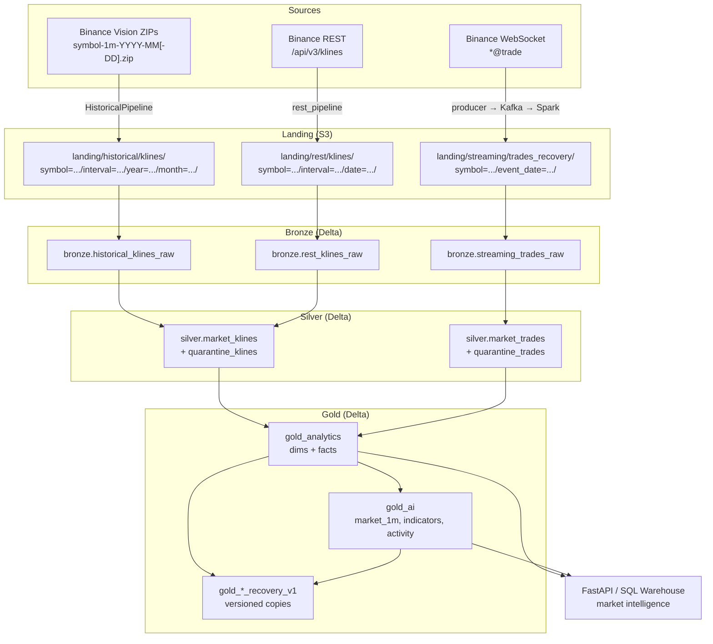
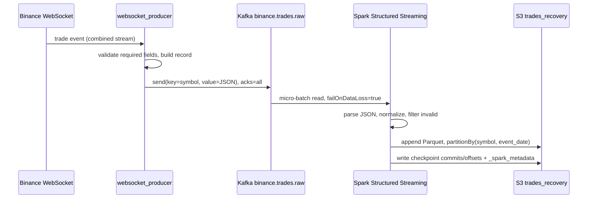

# Data Flow

## 1. Overview

Data reaches the serving layer through three landing paths that share the same S3 bucket and converge in Bronze:

1. **Historical batch** — Binance Vision ZIP archives → normalized Parquet
2. **REST batch** — Binance REST klines → Parquet
3. **Streaming** — WebSocket trades → Kafka → Spark → Parquet

Databricks Auto Loader ingests all three landing prefixes into Bronze, then Silver and Gold transform them.



## 2. Path A — Historical klines

Entry point: `python -m src.historical.run_historical_batch`

| Step | Code | Detail |
|---|---|---|
| Plan | `src/historical/historical_planner.py` | Partial months → daily archives; complete months → monthly archives; never includes today |
| Download | `src/historical/downloader.py` | Builds `data/spot/monthly/klines/...` or `data/spot/daily/klines/...` URLs; skips existing files |
| Checksum | `src/historical/checksum.py` | SHA-256 of source ZIP |
| Extract | `src/historical/archive_extractor.py` | Extracts ZIP to local folder |
| Read | `src/historical/file_reader.py` | Reads CSV into records |
| Validate | `src/historical/historical_validator.py` | Enforces Binance kline schema and value rules |
| Normalize | `src/historical/normalizer.py` | Standard column names/types |
| Parquet | `src/historical/parquet_writer.py` | Snappy-compressed Parquet bytes |
| Key | `HistoricalPipeline.build_s3_key()` | Deterministic key from symbol/interval/year/month parsed from archive name |
| Idempotency | `S3Client.object_exists()` | Existing object → `SKIPPED_ALREADY_EXISTS` audit, no rewrite |
| Publish | `S3Client.upload_parquet()` | Upload to S3 |
| Audit | `src/audit/historical_audit_logger.py` | `metadata/audit/historical/...` |

S3 key pattern:

```text
landing/historical/klines/
  symbol=BTCUSDT/
  interval=1m/
  year=2025/
  month=01/
  BTCUSDT-1m-2025-01.parquet
```

## 3. Path B — REST klines

Entry point: `python -m src.pipeline.rest_pipeline` (also invoked hourly by `binance_end_to_end`)

| Step | Code | Detail |
|---|---|---|
| Extract | `BinanceRESTClient.get_klines()` | 100 latest 1m candles per symbol; retries on 429/5xx/timeouts with exponential backoff |
| Validate | `validate_kline_response()` | 12 fields per candle, integer timestamps, increasing open times, non-negative prices/volume |
| Transform | `convert_klines_to_parquet()` | Parquet bytes with symbol/interval fields |
| Key | `rest_pipeline.py` | Date/time + UUID run ID |
| Publish | `S3Client.upload_parquet()` | Partitioned by symbol, interval, date |
| Checkpoint | `CheckpointManager.save_checkpoint()` | `metadata/checkpoints/rest/klines/<symbol>_<interval>.json` |
| Audit | `create_audit_record()` | `metadata/ingestion_audit/date=<YYYY-MM-DD>/...` |
| Failure | `S3Client.upload_quarantine()` | Failed payload written to `quarantine/` |

S3 key pattern:

```text
landing/rest/klines/
  symbol=BTCUSDT/
  interval=1m/
  date=2026-11-21/
  klines_HHMMSS_<pipeline_run_id>.parquet
```

Bronze applies `fix_rest_timestamps()` to correct an observed millisecond-to-microsecond epoch error on `open_time` and `close_time` for suspicious pre-2020 timestamps.

## 4. Path C — Streaming trades

Entry point: `python -m src.streaming.websocket_producer` plus the `spark-streaming` container.



Configuration:

| Setting | Default / source |
|---|---|
| Kafka topic | `binance.trades.raw` |
| Kafka partitions | 3 (`KAFKA_NUM_PARTITIONS`) |
| Producer streams | `btcusdt@trade`, `ethusdt@trade`, `solusdt@trade` |
| Producer guarantees | `acks=all`, `retries=10`, one in-flight request |
| Spark output | `s3a://<bucket>/landing/streaming/trades_recovery/` |
| Spark checkpoint | `s3a://<bucket>/metadata/checkpoints/binance_trades_streaming_v2/` |
| File-sink metadata | `<output>/_spark_metadata/` |
| Trigger | 30 seconds |

The recovery Spark job (`src/streaming/spark_to_s3_recovery.py`) is the one launched by Docker Compose. It uses a schema matching the producer payload, casts prices/quantities to `decimal(30,12)`, converts epoch millisecond fields to timestamps, and partitions output by `symbol` and `event_date`.

## 5. S3 prefix inventory

| Prefix | Producer | Consumer |
|---|---|---|
| `landing/historical/klines/` | Historical batch | Bronze Auto Loader |
| `landing/rest/klines/` | REST batch | Bronze Auto Loader |
| `landing/streaming/trades_recovery/` | Spark streaming | Bronze Auto Loader |
| `landing/streaming/trades/` | Legacy stream (retained) | Not the active Bronze source |
| `metadata/audit/historical/` | Historical batch | Audit/ops |
| `metadata/ingestion_audit/` | REST batch | Audit/ops |
| `metadata/checkpoints/rest/klines/` | REST batch | Operational recovery |
| `metadata/checkpoints/binance_trades_streaming_v2/` | Spark streaming | Spark + Airflow monitor |
| `metadata/databricks/schemas/...` | Bronze Auto Loader | Schema inference state |
| `metadata/databricks/checkpoints/...` | Bronze Auto Loader | Exactly-once ingestion state |
| `quarantine/` | REST batch | Investigation |

## 6. Layer contracts

### Bronze

Append-only raw tables with lineage columns added by Auto Loader:

| Column | Meaning |
|---|---|
| `_source_file` | Source Parquet path |
| `_source_system` | `binance_vision`, `binance_rest`, or `binance_stream` |
| `_ingested_at` | Ingestion timestamp (UTC session) |

### Silver

| Table | Grain | Key | Dedupe rule |
|---|---|---|---|
| `silver.market_trades` | One row per trade | `(symbol, trade_id)` | Latest `ingested_at` wins |
| `silver.market_klines` | One row per candle | `(symbol, interval, open_time)` | Historical source priority, then latest `ingested_at` |

Rejected rows are written to `silver.quarantine_trades` / `silver.quarantine_klines` with a `rejection_reason` and `quarantined_at`.

### Gold

| Table | Grain |
|---|---|
| `gold_analytics.dim_date` | One row per calendar date |
| `gold_analytics.dim_time` | One row per minute of day (0–1439, UTC) |
| `gold_analytics.dim_symbol` | One row per symbol |
| `gold_analytics.dim_interval` | One row per candle interval |
| `gold_analytics.fact_market_klines` | One row per symbol + interval + open_time |
| `gold_analytics.fact_market_trades` | One row per symbol + trade_id |
| `gold_ai.market_1m` | One row per symbol + interval + minute |
| `gold_ai.market_indicators` | One row per symbol + interval + minute |
| `gold_ai.market_activity` | One row per symbol + minute |

All Gold timestamps and date/time keys are standardized to UTC.

## 7. Orchestration touchpoints

| DAG | Schedule | Role in data flow |
|---|---|---|
| `binance_historical_backfill` | Manual | Runs local historical batch over `data/historical/` |
| `binance_end_to_end` | `0 * * * *` (currently paused) | REST ingestion → Bronze → Silver → Gold → quality → API health |
| `binance_streaming_monitor` | `*/5 * * * *` | Freshness, checkpoint/file-sink continuity, orphan count, Kafka lag |

Details: [Airflow Setup](../deployment/airflow_setup.md), [Streaming Pipeline](../pipeline/streaming.md).
