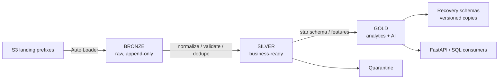
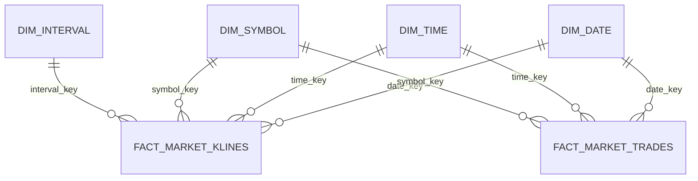

# Medallion Architecture

## 1. Design principles

The Databricks layer follows a medallion pattern in the `binance_data` Unity Catalog:



| Layer | Schema(s) | Write pattern | Contract |
|---|---|---|---|
| Bronze | `binance_data.bronze` | Auto Loader streaming writes, append-only | Preserve source payload + lineage; no business filtering |
| Silver | `binance_data.silver` | Delta `MERGE` upsert after first full create | Typed, validated, deduplicated business rows |
| Gold analytics | `binance_data.gold_analytics` | Full refresh (`overwrite`, `overwriteSchema`) | Dimensional model for reporting |
| Gold AI | `binance_data.gold_ai` | Full refresh | Enriched candles, indicators, activity aggregates |
| Quality | `binance_data.monitoring` | Validation queries | Assertion-based checks and diagnostics |
| Recovery | `binance_data.gold_analytics_recovery_v1`, `binance_data.gold_ai_recovery_v1` | Full refresh into isolated schemas | Non-destructive validation of Gold changes |

## 2. Bronze layer

Notebook: `databricks/notebooks/01_bronze/01.bronze_ingestion.py`

### Sources and targets

| Source S3 prefix | Delta table | Source system tag |
|---|---|---|
| `landing/historical/klines/` | `bronze.historical_klines_raw` | `binance_vision` |
| `landing/rest/klines/` | `bronze.rest_klines_raw` | `binance_rest` |
| `landing/streaming/trades_recovery/` | `bronze.streaming_trades_raw` | `binance_stream` |

### Ingestion mechanism

- `spark.readStream.format("cloudFiles")` with `cloudFiles.format=parquet`
- `cloudFiles.schemaEvolutionMode=addNewColumns`
- `cloudFiles.maxFilesPerTrigger=1000`
- `trigger(availableNow=True)` so each job run processes the currently available files and terminates
- Writes with `.format("delta").outputMode("append").toTable(...)`

### Lineage columns

| Column | Type / source |
|---|---|
| `_source_file` | `_metadata.file_path` |
| `_source_system` | Literal per ingestion function |
| `_ingested_at` | `current_timestamp()` |

### Checkpoint and schema isolation

Each source has its own schema location and checkpoint:

```text
s3a://binance-market-data-lake/metadata/databricks/
  schemas/
    historical_klines/<RUN_SUFFIX>/
    rest_klines/<RUN_SUFFIX>/
    streaming_trades/<STREAMING_RUN_SUFFIX>/
  checkpoints/
    historical_klines/<RUN_SUFFIX>/
    rest_klines/<RUN_SUFFIX>/
    streaming_trades/<STREAMING_RUN_SUFFIX>/
```

| Suffix | Value | Applies to |
|---|---|---|
| `RUN_SUFFIX` | `bronze_rebuild_20261021_v3` | Historical + REST |
| `STREAMING_RUN_SUFFIX` | `bronze_streaming_recovery_20261101_v1` | Streaming trades only |

The streaming-only suffix prevents the Phase 6 source switch from reprocessing historical/REST data.

### REST timestamp correction

`fix_rest_timestamps()` corrects `open_time` and `close_time` when they fall before `2020-01-01`, multiplying `unix_micros` by 1000. Validation fails the Bronze job if invalid timestamps remain.

## 3. Silver layer

### `silver.market_trades`

Notebook: `databricks/notebooks/02_silver/02.silver_trades.py`

| Aspect | Implementation |
|---|---|
| Source | `bronze.streaming_trades_raw` |
| Grain | `(symbol, trade_id)` |
| Timestamp | `trade_time_ms` or `trade_timestamp`, auto-detecting epoch seconds/ms/µs or string |
| Numeric types | `price`, `quantity` → `decimal(30,12)`; `quote_value = price * quantity` |
| Dedupe | `row_number()` over `(symbol, trade_id)` ordered by `ingested_at DESC` |
| Write | Initial `overwrite`, then Delta `MERGE` with `whenMatchedUpdateAll()` / `whenNotMatchedInsertAll()` |
| Rejects | `silver.quarantine_trades` with `rejection_reason` |

Rejection reasons: `missing_symbol`, `unsupported_symbol`, `missing_trade_id`, `invalid_trade_timestamp`, `invalid_price`, `invalid_quantity`.

### `silver.market_klines`

Notebook: `databricks/notebooks/02_silver/03.silver_klines.py`

| Aspect | Implementation |
|---|---|
| Sources | `bronze.historical_klines_raw` + `bronze.rest_klines_raw` |
| Grain | `(symbol, interval, open_time)` |
| Normalization | Column aliases for timestamp, OHLC, volume, trade count fields; timestamps from epoch or native types |
| Dedupe priority | `binance_historical` = 1, `binance_rest` = 2, then latest `ingested_at` |
| Write | Initial `overwrite`, then Delta `MERGE` on the business key |
| Rejects | `silver.quarantine_klines` with `rejection_reason` |

Rejection reasons: `missing_symbol`, `unsupported_symbol`, `invalid_open_time`, `missing_ohlc`, `invalid_ohlc_relationship`, `invalid_base_volume`.

> **Note:** The exported `03.silver_klines.py` contains the validation/dedupe/write block twice. This is preserved intentionally in the repository copy to match the workspace exactly. The second block repeats the same logic on the same `combined` dataframe.

### Silver dedupe contract

- Window partition: `(symbol, trade_id)` for trades, `(symbol, interval, open_time)` for klines
- Ordering: latest ingestion first (plus source priority for klines)
- `row_number() == 1`
- Delta `MERGE` on the business key
- Silver reads the full Bronze table on each run, making dedupe defensive across full-table reprocessing

Consequence: duplicate or orphan Parquet files cannot create duplicate Silver business rows. A duplicate may update lineage columns (`ingested_at`, `source_file`) but not the payload when records are exact copies.

## 4. Gold analytics layer

Notebook: `databricks/notebooks/03_gold/04.gold_analytics.py`

### Star schema



| Table | Grain | Key | Notes |
|---|---|---|---|
| `dim_date` | Calendar date | `date_key` = `yyyyMMdd` int | Generated from min/max dates across klines and trades |
| `dim_time` | Minute of day | `time_key` = 0–1439 | UTC; includes hour, minute, label, day part |
| `dim_symbol` | Symbol | `symbol_key` = `xxhash64(symbol)` | Splits base/quote asset using known quote suffixes |
| `dim_interval` | Interval | `interval_key` = `xxhash64(interval)` | Converts `m/h/d/w` to minutes |
| `fact_market_klines` | Symbol + interval + open_time | surrogate keys + `open_time` | OHLC, volumes, trade count |
| `fact_market_trades` | Symbol + trade_id | `symbol_key` + `trade_id` | Price, quantity, quote value, taker side |

### Build steps

1. Verify Silver source tables and required columns.
2. Deduplicate Silver inputs with a payload-hash tiebreaker.
3. Build and validate dimensions (`fail_if_duplicate`).
4. Join facts to dimensions and standardize date/time keys to UTC.
5. Validate grains (`fail_if_empty`, duplicate-grain checks).
6. Full-refresh all six tables with `mode("overwrite")`, `overwriteSchema=true`.
7. Print row counts and list tables.

## 5. Gold AI layer

Notebook: `databricks/notebooks/03_gold/05.gold_ai_serving.py`

| Table | Content |
|---|---|
| `gold_ai.market_1m` | Enriched candles joined to all dimensions; one row per symbol + interval + minute |
| `gold_ai.market_indicators` | Lagged prices, returns (1m/5m/1h/24h), SMA 20/50, 1h volatility |
| `gold_ai.market_activity` | Per-symbol/minute trade counts, volumes, taker-side counts and quote volumes |

Indicator details:

- Returns are only computed when the elapsed time between the current and lagged minute matches the expected window (60s, 300s, 3600s, 86400s).
- SMA windows are row-based (`rowsBetween(-19, 0)` and `rowsBetween(-49, 0)`), i.e. candle counts, not elapsed time.
- Volatility uses `stddev_samp(return_1m)` over a 3600-second range window.

### Tables referenced but not created in this export

The AI notebook and the quality notebook reference:

- `binance_data.gold_ai.asset_snapshot`
- `binance_data.gold_ai.market_relationships`
- `binance_data.gold_ai.market_alerts`
- `binance_data.gold_analytics.asset_comparison`

These are consumed by `ai_serving/app.py` but are not produced by any notebook in the exported folder. They must be created elsewhere or added in a future revision.

## 6. Quality and monitoring

Notebook: `databricks/notebooks/04_quality/06.data_quality_checks.py`

Checks include:

- No duplicate trades or candles in Silver
- No invalid Silver trade prices/quantities
- All three expected symbols have snapshots
- Dimension key uniqueness
- Fact-to-dimension key consistency
- OHLC/volume validity
- Duplicate grain detection
- Time/date dimension consistency

Snapshot freshness is displayed but not failed: stale data is a valid state as long as it is not presented as current.

## 7. Recovery layer

| Notebook | Target schemas | Difference from production |
|---|---|---|
| `recovery/04.gold_analytics_recovery_v1.py` | `gold_analytics_recovery_v1` | Omits the Silver `%run` cells so it does not re-run Silver ingestion |
| `recovery/05.gold_ai_recovery_v1.py` | `gold_ai_recovery_v1` | Reads recovery analytics facts instead of production facts |

Both recovery jobs use full refresh inside isolated schemas, so they do not overwrite production Gold tables. See [Streaming Recovery](../troubleshooting/streaming_recovery.md#7-phase-6-validation-snapshot).
