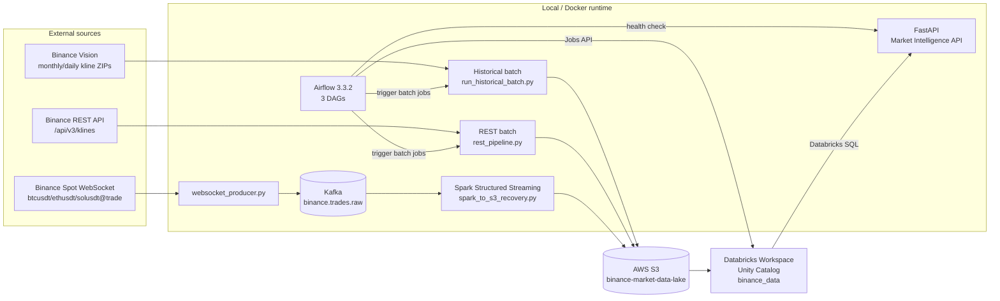

# System Architecture

## 1. Purpose and scope

This project ingests public Binance spot market data into an S3 data lake, processes it into a medallion architecture in Databricks, exposes curated datasets through a FastAPI service, and orchestrates/monitors the whole flow with Airflow.

Scope of this document:

- System context and component responsibilities
- Technology stack and deployment topology
- Trust boundaries and credential handling
- Current operational caveats

Related documents: [Data Flow](./data_flow.md), [Medallion Architecture](./medallion_architecture.md), [Airflow Setup](../deployment/airflow_setup.md).

## 2. System context

### Source systems

| Source | Data | Access pattern | Code |
|---|---|---|---|
| Binance Vision | Historical 1m klines, monthly and daily ZIP archives | Batch download | `src/historical/downloader.py`, `src/historical/historical_planner.py` |
| Binance REST API | Latest 1m klines (100 per symbol per run) | Batch, hourly | `src/api/binance_rest.py`, `src/pipeline/rest_pipeline.py` |
| Binance Spot WebSocket | Real-time trade events | Continuous stream | `src/streaming/websocket_producer.py` |

### Processing and serving

| Component | Responsibility | Key files |
|---|---|---|
| Historical batch | Download, checksum, extract, validate, normalize, Parquet conversion, deterministic S3 key, audit | `src/historical/historical_pipeline.py`, `src/historical/run_historical_batch.py` |
| REST batch | Extract, validate, transform to Parquet, upload, checkpoint, audit/quarantine | `src/pipeline/rest_pipeline.py`, `src/storage/s3_client.py` |
| Streaming | WebSocket → Kafka → Spark → partitioned Parquet with checkpointing | `src/streaming/spark_to_s3_recovery.py` |
| Databricks | Bronze/Silver/Gold medallion layers and quality checks | `databricks/notebooks/**` |
| Airflow | Historical backfill (manual), end-to-end orchestration (hourly), streaming monitor (every 5 min) | `airflow/dags/*.py` |
| FastAPI | Read-only market intelligence endpoints over Gold tables | `ai_serving/app.py` |

## 3. Technology stack

| Area | Technology | Version / notes |
|---|---|---|
| Language | Python | 3.11 for AI serving image; 3.13/3.14 seen in local environments |
| Batch/stream processing | PySpark | 3.5.6 |
| Message bus | Apache Kafka | 4.1.0, topic `binance.trades.raw`, 3 partitions |
| Object storage | AWS S3 | Bucket `binance-market-data-lake` |
| Lakehouse | Databricks + Delta Lake + Unity Catalog | Catalog `binance_data` |
| Auto Loader | Databricks `cloudFiles` | Schema evolution `addNewColumns` |
| Orchestration | Apache Airflow | 3.3.2, LocalExecutor, PostgreSQL metadata DB |
| Serving | FastAPI + Uvicorn | `databricks-sql-connector` |
| Validation/testing | pytest | Tests in `tests/` and `src/historical/`, `src/streaming/` |

Dependency manifests:

- `requirements.txt` — local batch/streaming dependencies
- `airflow/requirements-airflow.txt` — Airflow image dependencies
- `ai_serving/requirements.txt` — API image dependencies

## 4. Deployment topology

All runtime services are defined in `docker-compose.yml`:

| Service | Container | Port / endpoint | Purpose |
|---|---|---|---|
| `kafka` | `binance-kafka` | `9092` (host), `29092` (internal) | Broker and controller |
| `kafka-offset-exporter` | `binance-kafka-offset-exporter` | writes `.run/kafka_latest.json` | Feeds Kafka lag monitor task |
| `spark` | `binance-spark` | — | Interactive/utility Spark container |
| `spark-streaming` | `binance-spark-streaming` | — | Runs `spark_to_s3_recovery.py` continuously |
| `ai-serving` | `binance-ai-serving` | `8000` | FastAPI service, `/health` |
| `airflow-postgres` | `binance-airflow-postgres` | internal | Airflow metadata DB |
| `airflow-api-server` | `binance-airflow-api-server` | `8082` | Airflow 3 API/UI |
| `airflow-scheduler` / `airflow-dag-processor` / `airflow-triggerer` | — | internal | Airflow execution components |
| `airflow-init` | `binance-airflow-init` | — | `airflow db migrate` |

Shared volumes:

- Project root mounted at `/opt/airflow/project` and `/opt/project`
- `kafka_data` for broker data
- `airflow_postgres_data` for metadata
- `spark_ivy` for Spark package cache
- `${USERPROFILE}/.aws` mounted read-only into Spark and Airflow containers

Databricks is external to Docker; Airflow triggers it through the Jobs REST API.

## 5. Trust boundaries and secrets

| Secret | Location | Used by |
|---|---|---|
| AWS credentials | `${USERPROFILE}/.aws` mounted read-only; standard provider chain | Historical/REST batch, Spark S3A, Airflow S3 checks |
| `S3_BUCKET`, AWS region, Kafka settings | Root `.env`, `airflow/.env`, compose environment | Local scripts and containers |
| Airflow secrets | Root `.env` (`AIRFLOW_DB_PASSWORD`, `AIRFLOW_API_SECRET_KEY`, `AIRFLOW_FERNET_KEY`, JWT secret) | Airflow services |
| Databricks connection | Airflow connection `databricks_default` (Host + Password/PAT) | `binance_end_to_end` DAG |
| Databricks SQL credentials | `ai_serving/.env` (`DATABRICKS_SERVER_HOSTNAME`, `DATABRICKS_HTTP_PATH`, `DATABRICKS_TOKEN`) | FastAPI service |

Rules:

- Never commit `.env`, `ai_serving/.env`, `credentials.txt`, or tokens.
- The notebooks in `databricks/notebooks/` were scanned and contain no secrets.
- Prefer Databricks secret scopes or cloud instance profiles in production over PATs in files.

## 6. Current operational caveats

These are documented in the streaming recovery runbook and reflected in the code:

- `binance_streaming_monitor` is active and runs every 5 minutes.
- `binance_end_to_end` is paused; resume only after an explicit Gold cutover decision. Databricks jobs have no native schedule — Airflow is the only trigger.
- Production Gold notebooks use full refresh (`mode("overwrite")`).
- A versioned, non-destructive Gold recovery path exists in `binance_data.gold_analytics_recovery_v1` and `binance_data.gold_ai_recovery_v1`.
- `gold_ai.asset_snapshot`, `market_relationships`, `market_alerts`, and `gold_analytics.asset_comparison` are consumed by the API but are not created by any notebook in the exported workspace folder.
- AWS region settings are inconsistent across components; see [AWS Setup](../deployment/aws_setup.md#5-region-consistency-warning).
