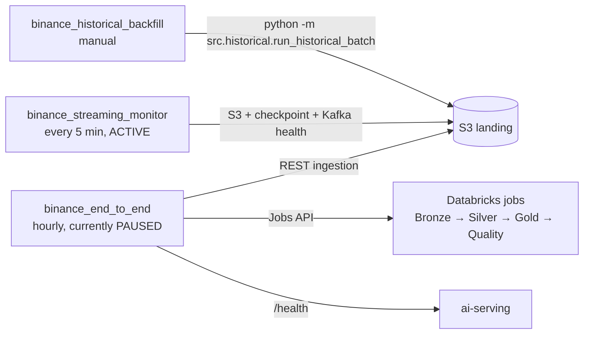
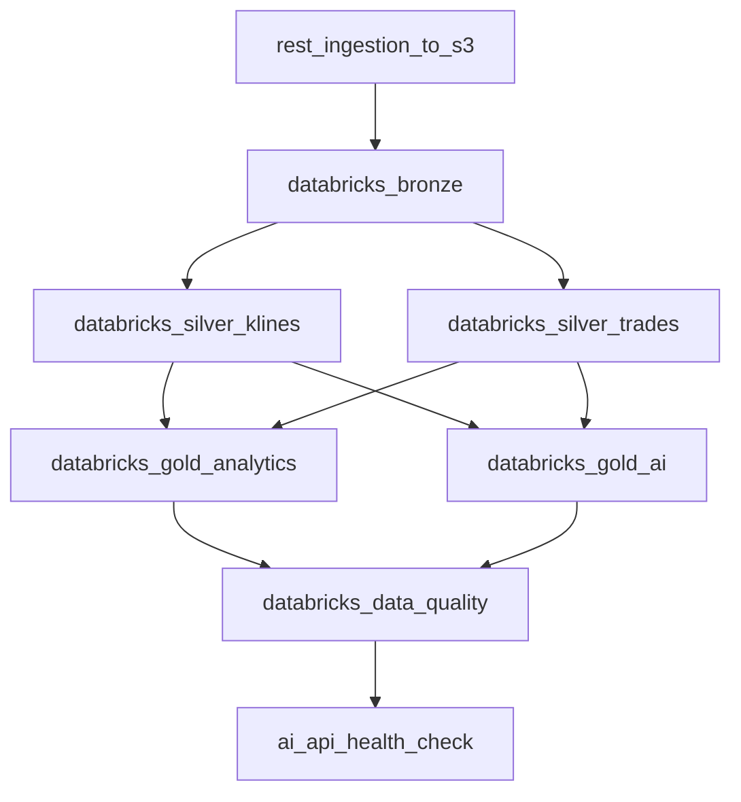

# Airflow Setup

Airflow 3.3.2 runs in Docker with a LocalExecutor and PostgreSQL metadata database. It orchestrates three DAGs:



## 1. Docker services

Defined in `docker-compose.yml`:

| Service | Container | Host port | Purpose |
|---|---|---|---|
| `airflow-init` | `binance-airflow-init` | — | `airflow db migrate` |
| `airflow-api-server` | `binance-airflow-api-server` | `8082` → `8080` | Airflow 3 API/UI |
| `airflow-scheduler` | `binance-airflow-scheduler` | — | Scheduling |
| `airflow-dag-processor` | `binance-airflow-dag-processor` | — | DAG parsing |
| `airflow-triggerer` | `binance-airflow-triggerer` | — | Deferrable operators |
| `airflow-postgres` | `binance-airflow-postgres` | — | Metadata DB |

Start the Airflow stack:

```powershell
docker compose up -d airflow-postgres airflow-init airflow-api-server airflow-scheduler airflow-dag-processor airflow-triggerer
```

Open the UI at `http://localhost:8082`.

Default SimpleAuth credentials are `admin:admin` in `docker-compose.yml`. This is for local use only. Change the auth manager and credentials before any shared/production deployment.

Required secrets in root `.env`:

```text
AIRFLOW_DB_PASSWORD
AIRFLOW_API_SECRET_KEY
AIRFLOW_FERNET_KEY
AIRFLOW__API_AUTH__JWT_SECRET
```

The project root is mounted at `/opt/airflow/project`; DAGs are mounted from `./airflow/dags`.

## 2. DAG inventory

| DAG | File | Schedule | State | Timeout / retries |
|---|---|---|---|---|
| `binance_historical_backfill` | `airflow/dags/binance_historical_backfill.py` | Manual (`schedule=None`) | Available | 6 h task timeout, 1 retry |
| `binance_end_to_end` | `airflow/dags/binance_end_to_end.py` | `0 * * * *` | **Paused** pending Gold cutover | 9 h DAG timeout, 2 retries per task, `max_active_runs=1` |
| `binance_streaming_monitor` | `airflow/dags/binance_streaming_ingestion.py` | `*/5 * * * *` | **Active** | No custom timeout |

### `binance_historical_backfill`

Single task:

- `historical_backfill_to_s3` → `cd /opt/airflow/project && python -m src.historical.run_historical_batch`
- Trigger manually after placing ZIP archives under `data/historical/<SYMBOL>/`.

### `binance_end_to_end`

Task order:



| Task | Type | Detail |
|---|---|---|
| `rest_ingestion_to_s3` | BashOperator | Runs `python -m src.pipeline.rest_pipeline` |
| `databricks_bronze` | PythonOperator | Calls Jobs API `run-now`, waits for SUCCESS |
| `databricks_silver_klines` | PythonOperator | Same, via `DATABRICKS_SILVER_KLINES_JOB_ID` |
| `databricks_silver_trades` | PythonOperator | Same, via `DATABRICKS_SILVER_TRADES_JOB_ID` |
| `databricks_gold_analytics` | PythonOperator | Same, via `DATABRICKS_GOLD_ANALYTICS_JOB_ID` |
| `databricks_gold_ai` | PythonOperator | Same, via `DATABRICKS_GOLD_AI_JOB_ID` |
| `databricks_data_quality` | PythonOperator | Same, via `DATABRICKS_QUALITY_JOB_ID` |
| `ai_api_health_check` | PythonOperator | GET `AI_API_BASE_URL + AI_API_HEALTH_PATH` |

Databricks API behavior:

- Trigger: `POST {host}/api/2.1/jobs/run-now` with `{"job_id": <id>}`
- Poll: `GET {host}/api/2.1/jobs/runs/get?run_id=...` every 20 seconds
- Success only when `life_cycle_state = TERMINATED` and `result_state = SUCCESS`
- Timeout after 2 hours; DAG-level timeout is 9 hours

`AI_API_BASE_URL` defaults to `http://ai-serving:8000` in the DAG code, but `docker-compose.yml` overrides it to `http://host.docker.internal:8000`. Set it to `http://ai-serving:8000` if you want in-network routing.

> **Do not unpause `binance_end_to_end` until the production Gold cutover policy is resolved.** Production Gold jobs full-refresh `binance_data.gold_analytics` and `binance_data.gold_ai` in place. See [Streaming Recovery](../troubleshooting/streaming_recovery.md#7-phase-6-validation-snapshot).

### `binance_streaming_monitor`

Four independent PythonOperators:

| Task | Check | Default threshold |
|---|---|---|
| `check_streaming_data_in_s3` | Newest `.parquet` object age in streaming prefix | 10 min |
| `check_spark_checkpoint_and_file_sink` | Checkpoint age, commit/offset gap, `_spark_metadata` coverage | 6 min |
| `check_orphan_files` | S3 Parquet files not tracked by file-sink metadata | 12 files |
| `check_kafka_lag` | Latest Kafka offsets minus Spark committed offsets | 5000 messages |

Relevant environment variables (set in `docker-compose.yml`):

```text
S3_BUCKET=binance-market-data-lake
S3_STREAMING_PREFIX=landing/streaming/trades_recovery/
S3_CHECKPOINT_PREFIX=metadata/checkpoints/binance_trades_streaming_v2/
STREAMING_FRESHNESS_MINUTES=10
STREAMING_CHECKPOINT_FRESHNESS_MINUTES=6
MAX_ORPHAN_FILES=12
KAFKA_TOPIC=binance.trades.raw
KAFKA_MAX_LAG_MESSAGES=5000
KAFKA_HEALTH_FRESHNESS_MINUTES=3
AWS_DEFAULT_REGION=ap-south-1
```

Kafka lag depends on `.run/kafka_latest.json`, written every 30 seconds by the `kafka-offset-exporter` container. Without it, `check_kafka_lag` fails.

## 3. Airflow CLI examples

Run these inside the API server container or an Airflow-enabled shell:

```powershell
# Show DAGs
docker compose exec airflow-api-server airflow dags list

# Pause/unpause
docker compose exec airflow-api-server airflow dags pause binance_end_to_end
docker compose exec airflow-api-server airflow dags unpause binance_streaming_monitor

# Trigger manual backfill
docker compose exec airflow-api-server airflow dags trigger binance_historical_backfill

# Trigger a one-off end-to-end run (only after cutover approval)
docker compose exec airflow-api-server airflow dags trigger binance_end_to_end

# List runs
docker compose exec airflow-api-server airflow dags list-runs -d binance_end_to_end
```

## 4. Databricks connection and variables

`binance_end_to_end` reads a connection named `databricks_default`:

| Field | Value |
|---|---|
| Conn ID | `databricks_default` |
| Host | `https://<workspace-host>` |
| Password | Personal access token or OAuth token |

The code uses `BaseHook.get_connection()` and `requests`, so the connection type is only a container for Host/Password.

Example CLI setup:

```powershell
docker compose exec airflow-api-server airflow connections add databricks_default `
  --conn-type http `
  --conn-host "https://<workspace-host>" `
  --conn-password "<token>"
```

Required Variables (numeric Databricks Job IDs):

| Variable | Job |
|---|---|
| `DATABRICKS_BRONZE_JOB_ID` | Bronze ingestion |
| `DATABRICKS_SILVER_KLINES_JOB_ID` | Silver klines |
| `DATABRICKS_SILVER_TRADES_JOB_ID` | Silver trades |
| `DATABRICKS_GOLD_ANALYTICS_JOB_ID` | Gold analytics |
| `DATABRICKS_GOLD_AI_JOB_ID` | Gold AI serving |
| `DATABRICKS_QUALITY_JOB_ID` | Data quality |

```powershell
docker compose exec airflow-api-server airflow variables set DATABRICKS_BRONZE_JOB_ID "<job-id>"
# ...repeat for the remaining five variables
docker compose exec airflow-api-server airflow variables list
```

Missing/empty variables or a missing token fail only the affected task at runtime; the DAG still parses.

## 5. Region and network notes

- `airflow-common` hardcodes `AWS_DEFAULT_REGION=ap-south-1` in `docker-compose.yml`, while `airflow/.env` may specify a different region. Align these with the real bucket region; see [AWS Setup](./aws_setup.md#5-region-consistency-warning).
- `${USERPROFILE}/.aws` is mounted read-only into Airflow containers. boto3 uses the default credential chain.
- The project root is mounted into Airflow, so `BashOperator` tasks can run local Python modules directly.
- Kafka is reached from Airflow only through the exported health file; no Kafka client library is needed in the DAG.
- `ai-serving` is published on host port `8000`; from inside the Airflow Docker network use `http://ai-serving:8000`.

## 6. Operational checklist

- [ ] `airflow db migrate` completed (`airflow-init` exited successfully).
- [ ] API/UI reachable on `http://localhost:8082`.
- [ ] `binance_streaming_monitor` is unpaused and all four tasks are green.
- [ ] `binance_end_to_end` remains paused unless explicitly approved.
- [ ] Six Databricks job ID Variables are set and numeric.
- [ ] `databricks_default` connection has a valid, non-expired token.
- [ ] `.run/kafka_latest.json` is fresh (less than 3 minutes old).
- [ ] `ai-serving/health` returns `{"status":"ok"}`.

## 7. Related documents

- [Databricks Setup](./databricks_setup.md)
- [AWS Setup](./aws_setup.md)
- [Streaming Pipeline](../pipeline/streaming.md)
- [Streaming Recovery](../troubleshooting/streaming_recovery.md)
