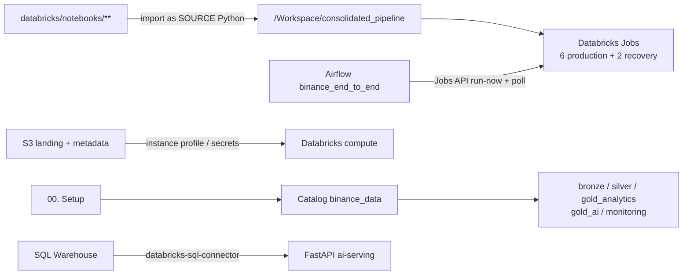

# Databricks Setup

This page covers the workspace, compute, storage access, notebook import, and Jobs configuration required by the medallion layer.



## 1. Workspace prerequisites

| Requirement | Detail |
|---|---|
| Unity Catalog | Enabled; catalog `binance_data` available |
| Compute | DBR with Delta Lake and Auto Loader (`cloudFiles`) support; Spark 3.5.x is used by local jobs |
| S3 access | Instance profile or service principal with read/write on `binance-market-data-lake` |
| Timezone | Session timezone set to `UTC` by ingestion notebooks |
| SQL Warehouse | Required by `ai_serving/app.py`; capture the HTTP path |
| PAT / OAuth token | Used by Airflow to call the Jobs API; prefer a service principal or secret scope over a personal token in production |
| Permissions | `CREATE CATALOG`/`CREATE SCHEMA`, `CREATE TABLE`, `WRITE FILES` to the S3 metadata prefixes |

The workspace host is referenced in `ai_serving/.env` as `DATABRICKS_SERVER_HOSTNAME` and configured in Airflow connection `databricks_default`. Do not commit tokens.

> **Operational note:** previously stored Databricks tokens returned `403 Invalid access token`. Generate a fresh token or use OAuth, then update both Airflow and the API environment before testing.

## 2. Catalog and schemas

`databricks/notebooks/00_setup/00. Setup.py` creates:

```sql
CREATE CATALOG IF NOT EXISTS binance_data;
CREATE SCHEMA IF NOT EXISTS binance_data.bronze;
CREATE SCHEMA IF NOT EXISTS binance_data.silver;
CREATE SCHEMA IF NOT EXISTS binance_data.gold_analytics;
CREATE SCHEMA IF NOT EXISTS binance_data.gold_ai;
CREATE SCHEMA IF NOT EXISTS binance_data.monitoring;
```

Recovery schemas are created by the recovery notebooks themselves:

- `binance_data.gold_analytics_recovery_v1`
- `binance_data.gold_ai_recovery_v1`

`databricks/notebooks/00_setup/00.configure.py` defines shared S3 constants, but most downstream notebooks redefine their own values locally; treat the local notebook values as authoritative.

## 3. Notebook import

All notebooks are Databricks **SOURCE**-format Python files. Import them with the exact workspace paths below; the `%run` statements use absolute paths and will fail if the folder is renamed.

| Repo file | Workspace path |
|---|---|
| `notebooks/00_setup/00. Setup.py` | `/Workspace/consolidated_pipeline/00. Setup` |
| `notebooks/00_setup/00.configure.py` | `/Workspace/consolidated_pipeline/00.configure` |
| `notebooks/01_bronze/01.bronze_ingestion.py` | `/Workspace/consolidated_pipeline/01.bronze_ingestion` |
| `notebooks/02_silver/02.silver_trades.py` | `/Workspace/consolidated_pipeline/02.silver_trades` |
| `notebooks/02_silver/03.silver_klines.py` | `/Workspace/consolidated_pipeline/03.silver_klines` |
| `notebooks/03_gold/04.gold_analytics.py` | `/Workspace/consolidated_pipeline/04.gold_analytics` |
| `notebooks/03_gold/05.gold_ai_serving.py` | `/Workspace/consolidated_pipeline/05.gold_ai_serving` |
| `notebooks/04_quality/06.data_quality_checks.py` | `/Workspace/consolidated_pipeline/06.data_quality_checks` |
| `notebooks/recovery/04.gold_analytics_recovery_v1.py` | `/Workspace/consolidated_pipeline/recovery/04.gold_analytics_recovery_v1` |
| `notebooks/recovery/05.gold_ai_recovery_v1.py` | `/Workspace/consolidated_pipeline/recovery/05.gold_ai_recovery_v1` |

Example using Databricks CLI:

```powershell
databricks workspace import `
  --format SOURCE `
  --language PYTHON `
  --overwrite `
  "databricks/notebooks/01_bronze/01.bronze_ingestion.py" `
  "/Workspace/consolidated_pipeline/01.bronze_ingestion"
```

Run `00. Setup` first. Then validate one layer at a time:

1. `01.bronze_ingestion`
2. `02.silver_trades` and `03.silver_klines`
3. `04.gold_analytics`
4. `05.gold_ai_serving`
5. `06.data_quality_checks`

> The repository copies are byte-for-byte exports. `03.silver_klines.py` and `06.data_quality_checks.py` contain duplicated blocks that were present in the workspace. Do not “clean up” only one side.

## 4. S3 paths and cluster access

The notebooks use these prefixes:

| Purpose | URI |
|---|---|
| Historical landing | `s3a://binance-market-data-lake/landing/historical/klines/` |
| REST landing | `s3a://binance-market-data-lake/landing/rest/klines/` |
| Streaming landing | `s3a://binance-market-data-lake/landing/streaming/trades_recovery/` |
| Auto Loader schemas | `s3a://binance-market-data-lake/metadata/databricks/schemas/...` |
| Auto Loader checkpoints | `s3a://binance-market-data-lake/metadata/databricks/checkpoints/...` |

Bronze suffixes:

| Source | Suffix |
|---|---|
| Historical + REST | `bronze_rebuild_20261021_v3` |
| Streaming trades | `bronze_streaming_recovery_20261101_v1` |

Do not change these suffixes without a full reprocessing plan: a new suffix makes Auto Loader treat existing files as new.

## 5. Databricks Jobs

Databricks jobs have **no native schedule** in this project. Airflow is the only production trigger.

### Production jobs

Create six jobs, each running one notebook on the shared compute:

| Job purpose | Notebook | Airflow Variable |
|---|---|---|
| Bronze ingestion | `01.bronze_ingestion` | `DATABRICKS_BRONZE_JOB_ID` |
| Silver trades | `02.silver_trades` | `DATABRICKS_SILVER_TRADES_JOB_ID` |
| Silver klines | `03.silver_klines` | `DATABRICKS_SILVER_KLINES_JOB_ID` |
| Gold analytics | `04.gold_analytics` | `DATABRICKS_GOLD_ANALYTICS_JOB_ID` |
| Gold AI serving | `05.gold_ai_serving` | `DATABRICKS_GOLD_AI_JOB_ID` |
| Data quality | `06.data_quality_checks` | `DATABRICKS_QUALITY_JOB_ID` |

Set the numeric Job IDs as Airflow Variables under **Admin → Variables**. See [Airflow Setup](./airflow_setup.md#4-databricks-connection-and-variables).

Job behavior to expect:

- Bronze uses `availableNow=True` Auto Loader streams and terminates when current files are processed.
- Silver notebooks `%run` Bronze first, so they also ingest Bronze data.
- Gold analytics `%run`s both Silver notebooks.
- Gold AI `%run`s Gold analytics.
- Gold jobs use `.mode("overwrite")` with `overwriteSchema=true`; every run replaces production Gold tables.
- Data quality hard-fails on duplicate/invalid rows. Snapshot freshness is displayed but does not fail.

### Recovery jobs

| Job | Job ID | Target |
|---|---|---|
| `binance_gold_analytics_recovery_v1` | `625607989294712` | `binance_data.gold_analytics_recovery_v1` |
| `binance_gold_ai_recovery_v1` | `115647081691022` | `binance_data.gold_ai_recovery_v1` |

Recovery jobs are unscheduled and must be triggered manually. The analytics recovery notebook omits the Silver `%run` cells, so it does not re-run upstream ingestion.

## 6. SQL Warehouse and API credentials

`ai_serving/app.py` reads:

```text
DATABRICKS_SERVER_HOSTNAME
DATABRICKS_HTTP_PATH
DATABRICKS_TOKEN
```

These live in `ai_serving/.env` and are mounted into the `ai-serving` container by `docker-compose.yml`.

Steps:

1. Create or select a SQL Warehouse.
2. Copy its HTTP path to `DATABRICKS_HTTP_PATH`.
3. Grant the token SELECT on the Gold tables used by the API.
4. Start `ai-serving` and call `http://localhost:8000/health`.

The API expects these tables:

| Schema | Table | Created by exported notebooks? |
|---|---|---|
| `gold_ai` | `asset_snapshot` | No |
| `gold_analytics` | `asset_comparison` | No |
| `gold_ai` | `market_relationships` | No |
| `gold_ai` | `market_alerts` | No |
| `gold_ai` | `data_dictionary` | No (referenced by quality notebook preview) |

They must be produced by another process before all API endpoints work. Queries against missing tables will raise an error.

## 7. Verification

After import and job creation:

```sql
SELECT COUNT(*) AS bronze_trades FROM binance_data.bronze.streaming_trades_raw;
SELECT COUNT(*) AS silver_trades FROM binance_data.silver.market_trades;
SELECT COUNT(*) AS fact_trades FROM binance_data.gold_analytics.fact_market_trades;
SELECT COUNT(*) AS ai_1m FROM binance_data.gold_ai.market_1m;
SHOW TABLES IN binance_data.monitoring;
```

Expected relationships:

- Bronze raw count ≥ Silver trade count (Bronze is append-only).
- Silver trade unique key count equals `gold_analytics.fact_market_trades` count after a successful full refresh.
- The data quality job completes without assertion failures.

## 8. Related documents

- [Databricks Notebooks README](../../databricks/README.md)
- [Medallion Architecture](../architecture/medallion_architecture.md)
- [Airflow Setup](./airflow_setup.md)
- [Streaming Recovery](../troubleshooting/streaming_recovery.md)
