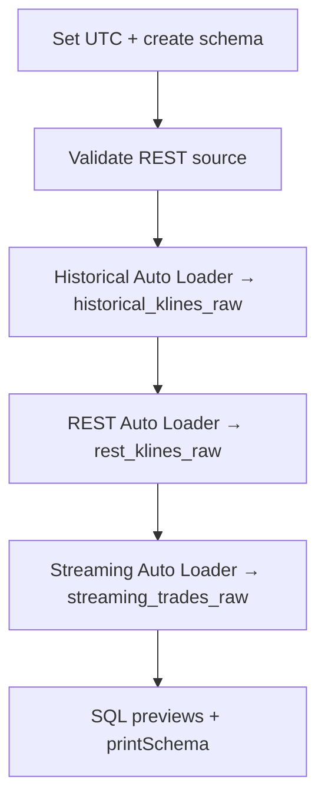

# Bronze Layer

Notebook: `databricks/notebooks/01_bronze/01.bronze_ingestion.py`  
Workspace path: `/Workspace/consolidated_pipeline/01.bronze_ingestion`  
Airflow job variable: `DATABRICKS_BRONZE_JOB_ID` (in `binance_end_to_end`)

## 1. Responsibility

Bronze lands raw S3 Parquet into Delta tables without business filtering. It:

- Adds source lineage columns
- Corrects a known REST timestamp defect
- Uses Auto Loader with per-source schema and checkpoint locations
- Appends only; it never deduplicates or rejects rows

Deduplication and validation happen in [Silver Layer](./silver_layer.md).

## 2. Configuration

The notebook `%run`s `/Workspace/consolidated_pipeline/00.configure`, then redefines most settings locally. The local values are authoritative.

| Setting | Value |
|---|---|
| Catalog/schema | `binance_data.bronze` |
| S3 root | `s3a://binance-market-data-lake` |
| Historical source | `landing/historical/klines/` |
| REST source | `landing/rest/klines/` |
| Streaming source | `landing/streaming/trades_recovery/` |
| Session timezone | `UTC` |

### Targets

| Source | Delta table | System tag |
|---|---|---|
| Historical | `binance_data.bronze.historical_klines_raw` | `binance_vision` |
| REST | `binance_data.bronze.rest_klines_raw` | `binance_rest` |
| Streaming | `binance_data.bronze.streaming_trades_raw` | `binance_stream` |

### Schema and checkpoint locations

| Source | Schema path | Checkpoint path |
|---|---|---|
| Historical | `metadata/databricks/schemas/historical_klines/bronze_rebuild_20261021_v3/` | `metadata/databricks/checkpoints/historical_klines/bronze_rebuild_20261021_v3/` |
| REST | `metadata/databricks/schemas/rest_klines/bronze_rebuild_20261021_v3/` | `metadata/databricks/checkpoints/rest_klines/bronze_rebuild_20261021_v3/` |
| Streaming | `metadata/databricks/schemas/streaming_trades/bronze_streaming_recovery_20261101_v1/` | `metadata/databricks/checkpoints/streaming_trades/bronze_streaming_recovery_20261101_v1/` |

The different streaming suffix is a deliberate Phase 6 change: it prevents the switch from `landing/streaming/trades/` to `landing/streaming/trades_recovery/` from reprocessing historical/REST sources.

## 3. Auto Loader function

`ingest_files_to_bronze(source_path, schema_path, checkpoint_path, target_table, source_system, file_format="parquet")`:

```python
source_df = (
    spark.readStream
    .format("cloudFiles")
    .option("cloudFiles.format", file_format.lower())
    .option("cloudFiles.schemaLocation", schema_path)
    .option("cloudFiles.schemaEvolutionMode", "addNewColumns")
    .option("cloudFiles.maxFilesPerTrigger", 1000)
    .load(source_path)
)
```

Supported formats: `parquet`, `json`, `csv`. The pipeline currently uses `parquet` for all three sources.

Lineage columns are added before writing:

```python
.withColumn("_source_file", F.col("_metadata.file_path"))
.withColumn("_source_system", F.lit(source_system))
.withColumn("_ingested_at", F.current_timestamp())
```

Write behavior:

```python
(source_df.writeStream
    .format("delta")
    .option("checkpointLocation", checkpoint_path)
    .option("mergeSchema", "true")
    .outputMode("append")
    .trigger(availableNow=True)
    .toTable(target_table))
query.awaitTermination()
```

`availableNow=True` makes the job process all files present at start time and then terminate, which suits Airflow-triggered batch execution.

## 4. REST timestamp correction

`fix_rest_timestamps(df)` addresses an observed epoch scaling error:

- Applies only to `open_time` and `close_time`
- Detects suspicious timestamps with `timestamp < '2020-01-01 00:00:00'`
- Rewrites them as `timestamp_micros(unix_micros(col) * 1000)`
- Leaves all other columns unchanged

Validation before ingestion:

- Requires `symbol`, `interval`, `open_time`, `close_time`, `open_price`, `high_price`, `low_price`, `close_price`
- Fails if any row has null symbol/timestamps, timestamps before cutoff, or `close_time < open_time`
- Displays per-symbol min/max timestamps before failing

The same correction is applied inside `ingest_files_to_bronze()` when `source_system == "binance_rest"`.

## 5. Execution order



All three ingestion functions run sequentially in one notebook execution. A failure in any one stops the job before later sources are processed.

## 6. Verification queries

The notebook ends with:

```sql
SELECT * FROM binance_data.bronze.streaming_trades_raw LIMIT 10;
SELECT * FROM binance_data.bronze.historical_klines_raw LIMIT 10;
SELECT * FROM binance_data.bronze.rest_klines_raw LIMIT 10;
```

and `printSchema()` for each table.

Additional checks:

```sql
-- Row counts by source system
SELECT _source_system, COUNT(*) AS rows
FROM binance_data.bronze.historical_klines_raw GROUP BY _source_system;

-- Duplicate raw files (lineage check)
SELECT _source_file, COUNT(*) AS rows
FROM binance_data.bronze.streaming_trades_raw
GROUP BY _source_file ORDER BY rows DESC LIMIT 20;
```

Bronze is append-only, so raw duplicate rows are expected; Silver is responsible for collapsing them.

## 7. Failure modes and handling

| Symptom | Likely cause | Action |
|---|---|---|
| REST validation fails | Source timestamps changed format | Inspect the displayed invalid rows; do not bypass the check |
| Auto Loader schema drift | New columns in source Parquet | `addNewColumns` + `mergeSchema` should handle it; verify schema path is writable |
| Streaming Bronze reads old data | Wrong checkpoint suffix | Confirm `STREAMING_RUN_SUFFIX` matches the runbook |
| Duplicate raw rows | Orphan/replayed S3 files | Expected; confirm Silver dedupe collapses them |

## 8. Related documents

- [Data Flow](../architecture/data_flow.md)
- [Medallion Architecture](../architecture/medallion_architecture.md)
- [Silver Layer](./silver_layer.md)
- [Streaming Recovery](../troubleshooting/streaming_recovery.md)
