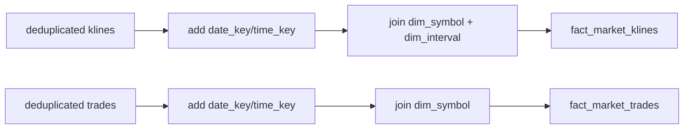

# Gold Layer

Two production notebooks build the Gold layer, plus two versioned recovery variants.

| Notebook | Workspace path | Airflow job variable | Destination |
|---|---|---|---|
| `databricks/notebooks/03_gold/04.gold_analytics.py` | `/Workspace/consolidated_pipeline/04.gold_analytics` | `DATABRICKS_GOLD_ANALYTICS_JOB_ID` | `binance_data.gold_analytics` |
| `databricks/notebooks/03_gold/05.gold_ai_serving.py` | `/Workspace/consolidated_pipeline/05.gold_ai_serving` | `DATABRICKS_GOLD_AI_JOB_ID` | `binance_data.gold_ai` |
| `databricks/notebooks/recovery/04.gold_analytics_recovery_v1.py` | `/Workspace/consolidated_pipeline/recovery/04.gold_analytics_recovery_v1` | Job ID `625607989294712` | `binance_data.gold_analytics_recovery_v1` |
| `databricks/notebooks/recovery/05.gold_ai_recovery_v1.py` | `/Workspace/consolidated_pipeline/recovery/05.gold_ai_recovery_v1` | Job ID `115647081691022` | `binance_data.gold_ai_recovery_v1` |

> **Important:** Both production Gold notebooks include `%run` chains that re-execute upstream notebooks. `04.gold_analytics.py` runs both Silver notebooks; `05.gold_ai_serving.py` runs `04.gold_analytics.py`. A single Gold AI job therefore re-runs Bronze, both Silver jobs, Gold analytics, and then Gold AI. The recovery analytics notebook deliberately omits the Silver `%run` cells.

## 1. Gold analytics build

### Source validation

Required Silver columns:

- Klines: `symbol`, `interval`, `open_time`, `close_time`, `open`, `high`, `low`, `close`, `base_volume`, `quote_volume`, `trade_count`, taker volumes, `ingested_at`, `source_file`
- Trades: `symbol`, `trade_id`, `trade_timestamp`, `price`, `quantity`, `quote_value`, `is_buyer_market_maker`, `ingested_at`, `source_file`

The notebook raises `ValueError` if required columns are missing or if either source table does not exist.

### Deduplication

`deduplicate_latest(df, business_keys)`:

1. Hashes all payload columns except `ingested_at` and `source_file` with SHA-256.
2. Orders by `ingested_at DESC`, `source_file DESC`, `_payload_hash DESC`.
3. Keeps `row_number() == 1` per business key.

Business keys:

- Klines: `(symbol, interval, open_time)`
- Trades: `(symbol, trade_id)`

### Dimension construction

| Dimension | Build logic |
|---|---|
| `dim_date` | Date sequence from min to max of kline `open_time` and trade `trade_timestamp`; keys like `20261121` |
| `dim_time` | `spark.range(1440)` → minute-of-day keys 0–1439 with hour, minute, label, day part |
| `dim_symbol` | Distinct symbols from both sources; base/quote split using known quote-asset suffixes; `symbol_key = xxhash64(symbol)` |
| `dim_interval` | Distinct intervals; `interval_key = xxhash64(interval)`; converts `m/h/d/w` to minutes |

`fail_if_duplicate()` is run for all four dimensions. A warning is printed if any quote asset is unrecognized.

### Fact construction



`fact_market_trades` includes a `taker_side` label:

- `is_buyer_market_maker = false` → `Buyer taker`
- `is_buyer_market_maker = true` → `Seller taker`
- null → `Unknown`

### Validation and write

Before writing:

- `fail_if_empty()` for all dimensions and facts
- Duplicate-grain checks on `(symbol_key, interval_key, open_time)` and `(symbol_key, trade_id)`

Write behavior:

```python
(dataframe.write
    .format("delta")
    .mode("overwrite")
    .option("overwriteSchema", "true")
    .saveAsTable(table_name))
```

All six tables are fully refreshed on every run. After writing, the notebook prints row counts and lists tables with `SHOW TABLES`.

## 2. Gold AI build

### `gold_ai.market_1m`

Joins Gold analytics facts to all four dimensions:

- Enriches candles with symbol, base/quote asset, interval metadata, calendar fields, time-of-day fields
- Casts decimal prices/volumes to `double`
- Adds `minute = date_trunc("minute", open_time)`
- Filters null symbol/minute/close price
- `dropDuplicates(["symbol", "interval", "minute"])`
- Full refresh write

### `gold_ai.market_indicators`

Window definition: `Window.partitionBy("symbol", "interval").orderBy("minute")`.

| Output | Logic |
|---|---|
| `previous_close_1/5/60/1440` | `lag(close_price, n)` |
| `previous_minute_1/5/60/1440` | `lag(minute, n)` |
| `return_1m/5m/1h/24h` | Price ratio minus 1, only when elapsed seconds equals 60/300/3600/86400 |
| `sma_20`, `sma_50` | Row-based averages over last 20/50 candles |
| `volatility_1h` | `stddev_samp(return_1m)` over a 3600-second range window |
| `calculated_at` | `current_timestamp()` |

Output columns exclude the intermediate lag columns.

### `gold_ai.market_activity`

Built from `fact_market_trades` joined to `dim_symbol`, aggregated by `(symbol, minute)`:

- `total_trades`, `total_quantity`, `total_quote_volume`
- `avg_trade_value`, `largest_trade_value`
- `buyer_taker_count`, `seller_taker_count`
- `buyer_taker_quote_volume`, `seller_taker_quote_volume`
- `calendar_date`, `calculated_at`

All three AI tables are full-refreshed with `overwriteSchema=true`.

### Post-write SQL previews

The notebook ends with preview queries for:

- `gold_ai.asset_snapshot`
- `gold_ai.market_relationships`
- `gold_ai.market_alerts`
- `gold_ai.data_dictionary` (in the production notebook)

These tables are not created by the exported notebooks. They are expected from another process before the API or quality checks can work end-to-end.

## 3. Recovery notebooks

| Production | Recovery equivalent |
|---|---|
| `04.gold_analytics.py` | `recovery/04.gold_analytics_recovery_v1.py` — same star schema build into `gold_analytics_recovery_v1`; Silver `%run` cells removed |
| `05.gold_ai_serving.py` | `recovery/05.gold_ai_recovery_v1.py` — reads recovery analytics facts, writes into `gold_ai_recovery_v1` |

Recovery jobs:

- `binance_gold_analytics_recovery_v1` — job ID `625607989294712`
- `binance_gold_ai_recovery_v1` — job ID `115647081691022`

Both are full refresh but isolated from production schemas. See [Streaming Recovery](../troubleshooting/streaming_recovery.md#7-phase-6-validation-snapshot).

## 4. Data quality notebook

Notebook: `databricks/notebooks/04_quality/06.data_quality_checks.py`  
Airflow job variable: `DATABRICKS_QUALITY_JOB_ID`

`assert_no_rows(df, description)` fails the job when a check returns rows. Checks cover:

- Duplicate Silver trades and candles
- Invalid Silver trade values
- Missing AI snapshots for expected symbols
- Dimension key uniqueness
- Fact-to-dimension key consistency
- OHLC and volume validity
- Duplicate grain and time/date dimension consistency

Snapshot freshness is displayed only. Stale data is not treated as a hard failure, but must not be presented as current.

## 5. Operational cautions

- Production Gold jobs are full refresh; any manual change to a Gold table is lost on the next run.
- Old Delta versions of `fact_market_klines` were vacuumed; full rollback to pre-refresh state is not possible.
- Do not resume `binance_end_to_end` into production Gold until the cutover policy is resolved.
- If you import notebooks to a different workspace path, update all absolute `%run` references.
