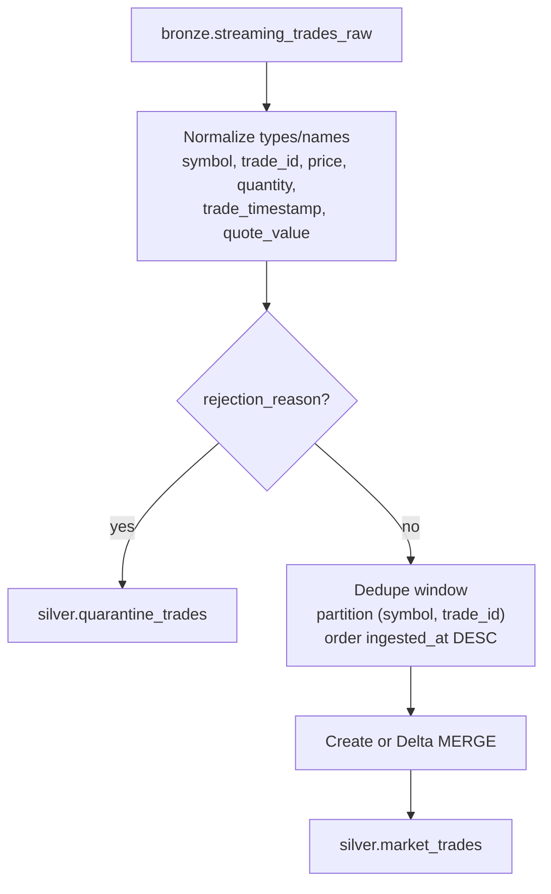
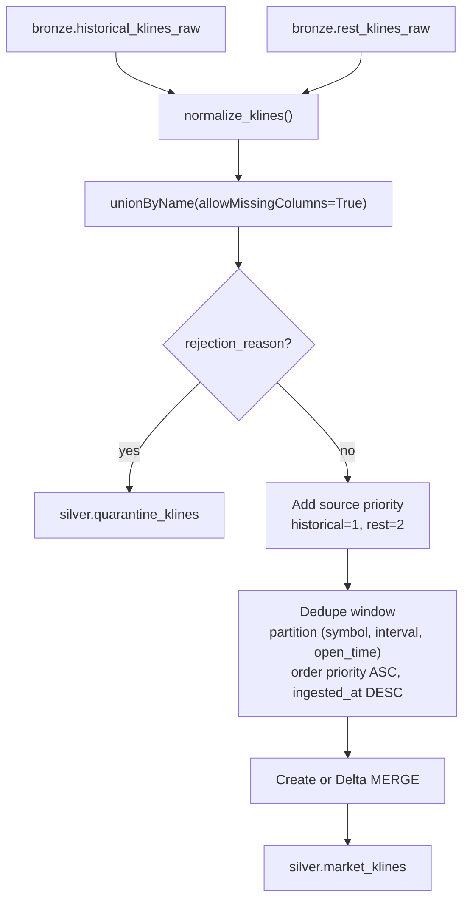

# Silver Layer

Two notebooks produce the Silver business tables. Both start by `%run`-ing the Bronze notebook, which means a Silver job run also re-executes Bronze ingestion.

| Notebook | Workspace path | Airflow job variable | Target |
|---|---|---|---|
| `databricks/notebooks/02_silver/02.silver_trades.py` | `/Workspace/consolidated_pipeline/02.silver_trades` | `DATABRICKS_SILVER_TRADES_JOB_ID` | `silver.market_trades`, `silver.quarantine_trades` |
| `databricks/notebooks/02_silver/03.silver_klines.py` | `/Workspace/consolidated_pipeline/03.silver_klines` | `DATABRICKS_SILVER_KLINES_JOB_ID` | `silver.market_klines`, `silver.quarantine_klines` |

## 1. Silver trades

### Transformation flow



### Timestamp handling

`epoch_to_timestamp(column_name)` supports:

| Magnitude of numeric value | Interpretation |
|---|---|
| `>= 100_000_000_000_000` | Microseconds → `timestamp_micros` |
| `>= 100_000_000_000` | Milliseconds → `timestamp_millis` |
| `>= 1_000_000_000` | Seconds → `from_unixtime` |
| otherwise | Direct `to_timestamp` |

The column is chosen as `trade_time_ms` if present, otherwise `trade_timestamp`. If neither exists, the notebook fails.

### Normalized contract

| Column | Derivation |
|---|---|
| `symbol` | Uppercase, trimmed string |
| `trade_id` | Cast to string |
| `price`, `quantity` | `decimal(30,12)` |
| `trade_timestamp` | Detected epoch/string conversion |
| `is_buyer_market_maker` | Cast to boolean, or null if column missing |
| `quote_value` | `price * quantity` |
| `source_file` | From `_source_file` |
| `ingested_at` | From `_ingested_at` |

### Rejection reasons

| Reason | Condition |
|---|---|
| `missing_symbol` | Symbol is null |
| `unsupported_symbol` | Symbol not in `BTCUSDT`, `ETHUSDT`, `SOLUSDT` |
| `missing_trade_id` | Trade ID is null |
| `invalid_trade_timestamp` | Trade timestamp is null |
| `invalid_price` | Price null or <= 0 |
| `invalid_quantity` | Quantity null or <= 0 |

Rejected rows are appended to `silver.quarantine_trades` with `quarantined_at`.

### Upsert contract

```python
Window.partitionBy("symbol", "trade_id").orderBy(F.col("ingested_at").desc_nulls_last())
# row_number() == 1
```

If `silver.market_trades` does not exist, the notebook creates it with `mode("overwrite")`. Otherwise it runs:

```python
target.alias("t").merge(
    silver_df.alias("s"),
    "t.symbol = s.symbol AND t.trade_id = s.trade_id",
).whenMatchedUpdateAll().whenNotMatchedInsertAll().execute()
```

## 2. Silver klines

### Transformation flow



### Normalization

`normalize_klines(df, source_name)` handles alternate source column names:

| Output | Candidate input columns |
|---|---|
| `symbol` | `symbol` |
| `interval` | `interval`, `kline_interval` (default `1m`) |
| `open_time` / `close_time` | `*_time`, `*_time_ms`, `*_time_us` |
| `open` | `open_price`, `open` |
| `high` | `high_price`, `high` |
| `low` | `low_price`, `low` |
| `close` | `close_price`, `close` |
| `base_volume` | `volume`, `base_volume`, `base_asset_volume` |
| `quote_volume` | `quote_asset_volume`, `quote_volume` |
| `trade_count` | `number_of_trades`, `trade_count` |
| taker volumes | multiple `*_base_asset_volume` / `*_quote_asset_volume` aliases |

Numeric timestamps are converted based on magnitude (microseconds, milliseconds, or seconds), analogous to the trade timestamp logic.

### Rejection reasons

| Reason | Condition |
|---|---|
| `missing_symbol` | Symbol is null |
| `unsupported_symbol` | Symbol not in the supported set |
| `invalid_open_time` | Open time is null |
| `missing_ohlc` | Any OHLC value is null |
| `invalid_ohlc_relationship` | `low > high`, or open/close outside `[low, high]` |
| `invalid_base_volume` | Base volume null or negative |

### Source priority and upsert

```python
source_priority = (
    F.when(F.col("source_system") == "binance_historical", 1)
     .when(F.col("source_system") == "binance_rest", 2)
     .otherwise(99)
)

Window.partitionBy("symbol", "interval", "open_time").orderBy(
    F.col("_priority").asc(),
    F.col("ingested_at").desc_nulls_last(),
)
```

The historical/official candle wins over REST for overlapping keys. The Delta merge key is `(symbol, interval, open_time)` with `whenMatchedUpdateAll()` / `whenNotMatchedInsertAll()`.

> **Note:** The exported notebook repeats the entire validation → dedupe → write block a second time. Both blocks operate on the same `combined` dataframe and implement the same logic, so the outcome is unchanged. The repository copy preserves this exactly as exported. If you clean it up in Databricks, update the repository copy too.

## 3. Quality queries at the end of the klines notebook

The notebook runs four SQL checks:

1. Duplicate trades by `(symbol, trade_id)`
2. Duplicate klines by `(symbol, interval, open_time)`
3. Symbol coverage for trades vs klines
4. Timestamp coverage (first/last candle and count per symbol)

Expected result: zero rows for checks 1 and 2.

## 4. Idempotency and reruns

| Concern | Behavior |
|---|---|
| Re-running a Silver notebook | Re-reads full Bronze, re-dedupes, then MERGEs; no duplicate business rows |
| Orphan Parquet files in Bronze landing | Collapsed by `(symbol, trade_id)` dedupe; may update lineage columns |
| Quarantine tables | Append-only; reruns can append the same rejected row again |
| Source-file lineage | A duplicate with later `ingested_at` can replace `source_file`; see recovery runbook |

## 5. Related documents

- [Bronze Layer](./bronze_layer.md)
- [Gold Layer](./gold_layer.md)
- [Medallion Architecture](../architecture/medallion_architecture.md)
- [Streaming Recovery](../troubleshooting/streaming_recovery.md#6-silver-dedupe-contract)
