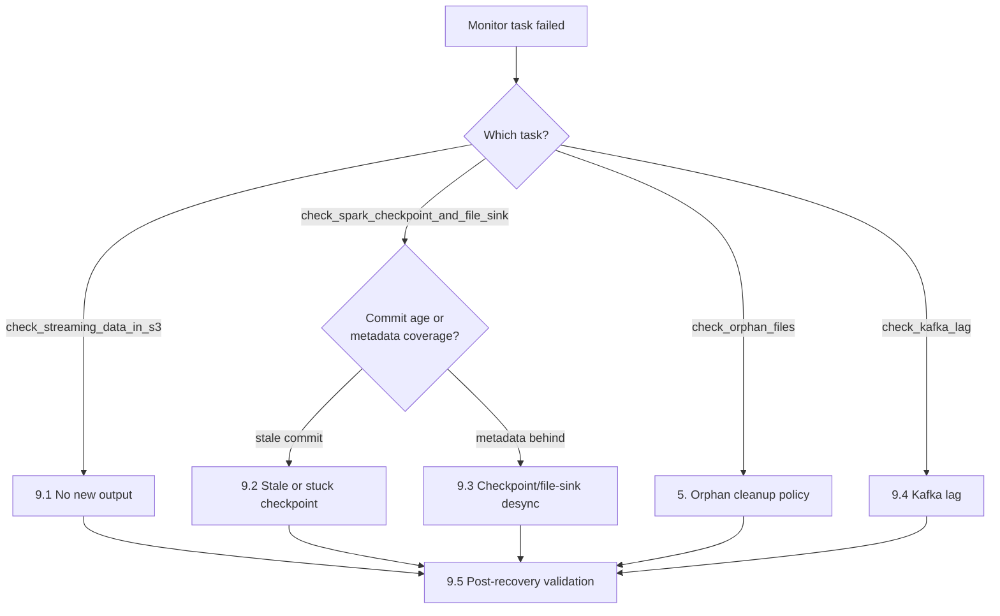

# Streaming Checkpoint and Orphan Recovery Runbook

Scope: the Kafka to Spark to S3 recovery stream.

- Kafka topic: `binance.trades.raw`
- Spark checkpoint: `s3://binance-market-data-lake/metadata/checkpoints/binance_trades_streaming_v2/`
- Spark output: `s3://binance-market-data-lake/landing/streaming/trades_recovery/`
- File-sink metadata: `s3://binance-market-data-lake/landing/streaming/trades_recovery/_spark_metadata/`
- Source job: `src/streaming/spark_to_s3_recovery.py`
- Airflow monitor: `binance_streaming_monitor`

## When to use this runbook

Use this document when any of the following happens:

- `binance_streaming_monitor` tasks fail or go stale.
- Spark streaming stops committing batches or `_spark_metadata` falls behind.
- Orphan Parquet objects appear in the live output prefix.
- You are about to restore a checkpoint, switch an output prefix, or clean up orphans.
- Bronze/Silver trade counts change unexpectedly after a stream restart.

This runbook covers the **Kafka → Spark → S3** path only. Historical and REST ingestion failures are covered in [Ingestion](../pipeline/ingestion.md); downstream transformation issues are covered in [Bronze Layer](../pipeline/bronze_layer.md) and [Silver Layer](../pipeline/silver_layer.md).

### Symptom → section

| Symptom | Go to |
|---|---|
| No new Parquet files, S3 freshness task fails | [9.1 No new output](#91-no-new-output) |
| Checkpoint age too high | [9.2 Stale or stuck checkpoint](#92-stale-or-stuck-checkpoint) |
| `_spark_metadata` behind commit | [9.3 Checkpoint/file-sink desync](#93-checkpointfile-sink-desync) |
| Orphan count increased | [5. Orphan Parquet retention and cleanup policy](#5-orphan-parquet-retention-and-cleanup-policy) |
| Kafka lag high | [9.4 Kafka lag](#94-kafka-lag) |
| Need to restore from backup | [1](#1-current-verified-backup), [3](#3-backup-procedure-for-future-changes), [4](#4-restore-procedure) |
| Need to validate a Phase 6-style change | [7](#7-phase-6-validation-snapshot), [9.5 Post-recovery validation](#95-post-recovery-validation) |

Phase 6 switched only the streaming Bronze source. Bronze now reads
`landing/streaming/trades_recovery/` through the streaming-only run suffix
`bronze_streaming_recovery_20261101_v1`. The historical/REST checkpoints remain on
`bronze_rebuild_20261021_v3`, and the old `landing/streaming/trades/` data remains in
the existing Bronze table. The Gold jobs are still explicit full-refresh writes; see
section 7 before resuming `binance_end_to_end`.

## 1. Current verified backup

A point-in-time backup was taken while the stream was live:

- Local root: `C:\Users\jades\AppData\Local\Temp\opencode\phase4_streaming_backup_20261101_131254`
- Checkpoint objects: 162
- File-sink metadata objects: 81
- Latest checkpoint commit: 79
- Latest checkpoint offset: 79
- Latest file-sink metadata batch: 80 (batch 79 is covered by `79.compact`)
- Missing file-sink batches: none
- Total backup size: 443,817 bytes
- Manifest: `<backup-root>\manifest.json` with S3 key, size, ETag, LastModified, and SHA-256

This backup contains checkpoint and file-sink metadata only. It does not contain the
Parquet output files. The output data remains in S3; it is not a full data backup.

The older `checkpoint_v2_backup_20261101_175351` backup is checkpoint-only and must
not be used alone for a restore.

S3 bucket versioning was not enabled at review time. Enable versioning or take a data
inventory/copy before any destructive cleanup or output-prefix change.

## 2. Stop the stream before a restore

Use targeted shutdown only:

1. Stop the producer process that owns the Binance WebSocket connection. Do not kill
   all Python processes.
2. Stop only the Spark streaming service:
   `docker compose stop spark-streaming`
3. Leave Kafka, Airflow, and the S3 data untouched unless the restore requires more.

Confirm no Spark process is still writing the checkpoint or `_spark_metadata`.

## 3. Backup procedure for future changes

Before a restore, path switch, or cleanup:

1. Stop writers or accept a documented point-in-time snapshot.
2. Copy every object under the checkpoint prefix, including:
   - `commits/`
   - `offsets/`
   - `sources/`
3. Copy every object under `_spark_metadata/`, including numeric batches and
   `*.compact` files.
4. Write a manifest with object keys, sizes, ETags, LastModified, and SHA-256.
5. Verify that every batch from `0` through the latest commit is covered by either
   a numeric metadata batch or a compact batch.
6. Verify that the latest commit and latest offset are a consistent pair. A latest
   offset one batch ahead of the latest commit is normal; a larger gap is not.

## 4. Restore procedure

### Option A: in-place restore to the same prefixes

Use this only when the output data after the backup can be accepted as duplicate
or orphaned and Silver dedupe will absorb it.

1. Stop the producer and Spark as described above.
2. Move the current checkpoint and `_spark_metadata` to a quarantine prefix. Do not
   hard-delete them.
3. Restore the backup checkpoint objects to the live checkpoint prefix.
4. Restore the backup `_spark_metadata` objects to the live output prefix.
5. Keep the checkpoint and metadata from the same backup snapshot.
6. Start Spark and confirm the checkpoint and file-sink monitor tasks pass.
7. Review output files written after the backup timestamp as potential duplicates
   or orphans. Do not assume they are safe without reviewing their keys.

### Option B: restore to a new output prefix

The `_spark_metadata` entries contain absolute output paths, so copying metadata
to a new prefix without rewriting those paths is not a valid restore.

Choose one of these supported approaches:

- Copy the tracked Parquet files to the new output prefix and rewrite every
  `_spark_metadata` path to the new prefix, then restore the matching checkpoint.
- Start a new stream with a new checkpoint and output prefix, using an explicit
  `startingOffsets` policy. Record whether that policy can replay or skip data.

Do not use half of one approach and half of the other.

### Hard rules

- Never restore a checkpoint without its matching `_spark_metadata`.
- Do not invent metadata for a missing batch. The empty batch 20 repair was valid
  only because that batch wrote no files and `commits/20` already existed.
- Keep `failOnDataLoss=true`. Do not silently skip missing offsets.
- Kafka retention is currently seven days. A restore that depends on replaying old
  offsets must complete before those offsets expire.
- After restore, run the monitor manually and confirm:
  - S3 freshness
  - checkpoint age
  - file-sink batch coverage
  - Kafka lag against the committed checkpoint

## 5. Orphan Parquet retention and cleanup policy

Current state: 12 orphan Parquet objects are exact duplicates of tracked rows:
4,505 rows, 1,545 unique `(symbol, trade_id)` keys, all present in tracked data,
with no payload conflicts. Three are older objects; nine came from the failed
batch-29 attempts.

Recommended policy:

1. Do not delete them now. They are safe to retain and Silver dedupe already treats
   the keys idempotently.
2. Keep them until the Phase 6 Bronze/Silver path switch and validation complete.
3. Before cleanup, take a fresh checkpoint plus `_spark_metadata` backup and an
   orphan object manifest.
4. Move, do not hard-delete: copy each orphan to a quarantine prefix such as
   `s3://binance-market-data-lake/quarantine/streaming_orphans/<timestamp>/`,
   preserving its relative path, then delete the source object.
5. Never move or delete tracked files or `_spark_metadata` objects as part of an
   orphan cleanup.
6. Verify the tracked file count and `_spark_metadata` are unchanged after the move.
7. Retain the quarantine copy for at least 30 days or until the next successful
   Bronze/Silver validation, whichever is later.
8. Re-run the orphan inventory after the move and confirm zero untracked files in
   the live output prefix.

The `binance_streaming_monitor` DAG now includes a `check_orphan_files` task.
It compares tracked file-sink paths with actual Parquet objects, fails if a
tracked file is missing, and fails if the orphan count exceeds
`MAX_ORPHAN_FILES` (currently 12). Raise the limit only after reviewing and
recording the new orphan files.

## 6. Silver dedupe contract

The Silver notebook uses:

- Window partition: `(symbol, trade_id)`
- Ordering: `ingested_at DESC`
- `row_number() == 1`
- Delta `MERGE` on `(symbol, trade_id)`
- `whenMatchedUpdateAll()` and `whenNotMatchedInsertAll()`

Consequences:

- Exact duplicate orphan rows cannot create duplicate Silver business rows.
- A duplicate can update `ingested_at` and `_source_file` to a later orphan path.
  It cannot change price, quantity, trade ID, or event timestamp if the payload is
  exact.
- If strict source-file lineage is required, keep the orphan files or update the
  Silver lineage policy before cleanup.
- Silver reads the full Bronze table on each run. The dedupe is defensive across
  full-table reprocessing, not only across one batch.

## 7. Phase 6 validation snapshot

Streaming-only Databricks configuration:

- Bronze source: `s3://binance-market-data-lake/landing/streaming/trades_recovery/`
- Bronze checkpoint: `s3://binance-market-data-lake/metadata/databricks/checkpoints/streaming_trades/bronze_streaming_recovery_20261101_v1/`
- Historical/REST suffix: `bronze_rebuild_20261021_v3` (unchanged)

Validated results after the switch:

- Bronze: 217,572 raw rows, 213,021 unique `(symbol, trade_id)` keys. Bronze is append-only.
- Silver `market_trades`: 213,021 rows, 213,021 unique `(symbol, trade_id)` keys, written
  with Delta `MERGE`; no quarantine rows were produced.
- The 4,551 raw duplicate rows collapsed by Silver include the 12 retained orphan
  Parquet files (4,505 rows). The orphans remain in place.
- Gold `fact_market_trades`: 213,021 rows. The current production Gold tables were
  full-refreshed by the existing pipeline at 13:59-14:00 UTC on 2026-11-01, before the
  versioned recovery path was created.
- `binance_streaming_monitor` is unpaused and its four checks pass.
- `binance_end_to_end` is paused. A 16:00 UTC scheduled run on 2026-11-02 was stopped
  before any Databricks task. The Databricks jobs have no native schedule; Airflow is
  the only trigger.

### Versioned Gold recovery path

The non-destructive Gold path is built and validated:

- `binance_data.gold_analytics_recovery_v1`
  - `dim_date`: 670
  - `dim_time`: 1,440
  - `dim_symbol`: 3
  - `dim_interval`: 1
  - `fact_market_klines`: 2,784,024
  - `fact_market_trades`: 213,021
- `binance_data.gold_ai_recovery_v1`
  - `market_1m`: 2,784,024
  - `market_indicators`: 2,784,024
  - `market_activity`: 527

Recovery jobs, both without a native schedule:

- `binance_gold_analytics_recovery_v1`: job ID `625607989294712`
- `binance_gold_ai_recovery_v1`: job ID `115647081691022`

Validated runs:

- Gold analytics recovery: `run_id 897636312259944` (success)
- Gold AI recovery: `run_id 778062515680054` (success)

The recovery notebooks live under `/Workspace/consolidated_pipeline/recovery/`. The
recovery analytics notebook deliberately omits the Silver `%run` cells, so it does not
re-run Silver ingestion as a side effect. The production Gold tables were unchanged by
these runs: `fact_market_trades` remained at version 21, `fact_market_klines` at version
23, and the Gold AI tables at version 8.

Do not resume `binance_end_to_end` into the production Gold tables until a cutover is
explicitly approved. The production Gold jobs still full-refresh
`binance_data.gold_analytics` and `binance_data.gold_ai` in place.

## 8. Known limitations

- The production Gold jobs remain full refresh (`.mode("overwrite")`) and replace the
  production Gold tables on every run.
- The recovery Gold jobs also use full refresh, but only inside the
  `gold_analytics_recovery_v1` and `gold_ai_recovery_v1` schemas.
- `binance_end_to_end` is paused until the production Gold cutover policy is resolved.
- Some old production Gold `fact_market_klines` versions were vacuumed at 18:31 on
  2026-11-01, so a full rollback to the pre-refresh Gold state is not possible.
- The Airflow monitor checks S3, the checkpoint/file-sink pair, and Kafka lag. It
  does not inspect the Spark container process directly; checkpoint age is the
  query-liveness signal.
- S3 bucket versioning is not enabled.

## 9. Troubleshooting quick reference



### 9.1 No new output

`check_streaming_data_in_s3` fails when the newest Parquet file is older than `STREAMING_FRESHNESS_MINUTES` (default 10) or the prefix has no Parquet files.

Check in this order:

```powershell
# Is Spark still running?
docker compose ps spark-streaming

# Are there recent Spark errors?
docker compose logs --tail=200 spark-streaming

# Is the producer still connected? Look for the process owning the WebSocket,
# then stop only that process if a restart is needed.
Get-CimInstance Win32_Process -Filter "Name like 'python%'" |
  Select-Object ProcessId, CommandLine

# Are new objects arriving?
aws s3 ls s3://binance-market-data-lake/landing/streaming/trades_recovery/ --recursive |
  Sort-Object { $_ -replace '.*\s(\d{4}-\d{2}-\d{2} \d{2}:\d{2}:\d{2}).*','$1' }
```

Common causes:

- Producer disconnected and the outer reconnect loop is blocked.
- `spark-streaming` container stopped or restarting.
- Kafka topic has no new messages (check `.run/kafka_latest.json` and broker logs).
- S3 credentials expired or the bucket region is wrong.
- Spark is reading a different checkpoint than the one being monitored.

Do **not** fix freshness by deleting the checkpoint. A new checkpoint with `startingOffsets=earliest` causes full topic replay; a new checkpoint with `latest` skips data. Both need an explicit decision.

### 9.2 Stale or stuck checkpoint

`check_spark_checkpoint_and_file_sink` fails when the latest commit is older than `STREAMING_CHECKPOINT_FRESHNESS_MINUTES` (default 6).

Inspect the checkpoint:

```powershell
aws s3 ls s3://binance-market-data-lake/metadata/checkpoints/binance_trades_streaming_v2/commits/ --recursive
aws s3 ls s3://binance-market-data-lake/metadata/checkpoints/binance_trades_streaming_v2/offsets/ --recursive
```

Interpretation:

| Observation | Meaning | Action |
|---|---|---|
| Commit and offset both frozen | Spark is not processing | Check container logs and Kafka liveness; see [2. Stop the stream before a restore](#2-stop-the-stream-before-a-restore) if intervention is needed |
| Offset = commit + 1 | One batch in flight | Normal; wait one trigger interval (30 s) |
| Offset > commit + 1 | Multiple uncommitted batches | Investigate Spark failures; do not edit checkpoint objects |
| Commit > offset | Corrupt checkpoint | Stop stream, take a fresh backup, then follow [4. Restore procedure](#4-restore-procedure) |

The monitor does not inspect the Spark process directly. A green freshness check means commits are advancing, not that the payload is correct.

### 9.3 Checkpoint/file-sink desync

The same task fails when `_spark_metadata` is behind the latest commit or a batch is missing from metadata coverage.

Inspect metadata:

```powershell
aws s3 ls s3://binance-market-data-lake/landing/streaming/trades_recovery/_spark_metadata/ --recursive
aws s3 cp s3://binance-market-data-lake/landing/streaming/trades_recovery/_spark_metadata/79 . --quiet
```

Rules from [4. Restore procedure](#4-restore-procedure):

- Restore a checkpoint only with its matching `_spark_metadata`.
- Keep `failOnDataLoss=true`.
- A `.compact` file is valid coverage for older batches; it does not mean a batch was skipped.
- Never invent a metadata entry for a batch that did not run. The empty batch 20 repair was valid only because `commits/20` already existed.
- `_spark_metadata` stores absolute output paths. Moving to a new prefix requires rewriting those paths or starting a new stream with an explicit `startingOffsets` policy.

If file-sink metadata is ahead of or behind the checkpoint by more than one batch, stop writers and take a fresh point-in-time backup before making changes.

### 9.4 Kafka lag

`check_kafka_lag` fails when committed offsets lag latest offsets by more than `KAFKA_MAX_LAG_MESSAGES` (default 5000), when partition sets mismatch, or when lag is negative.

Health file written by `kafka-offset-exporter`:

```powershell
Get-Content .run\kafka_latest.json
```

Example shape:

```json
{"timestamp":"2026-11-21T12:00:00Z","topic":"binance.trades.raw","offsets":"0:12345,1:11987,2:12102"}
```

Checks:

- File age must be under `KAFKA_HEALTH_FRESHNESS_MINUTES` (default 3). If stale, restart `kafka-offset-exporter`; the monitor depends on this file.
- Spark committed offsets come from the checkpoint batch at or before the health snapshot time.
- Partition set must match the broker's topic partitions (3).
- Negative lag usually means clock/snapshot skew; verify timestamps before changing offsets.
- Sustained positive lag means Spark throughput is below producer throughput. Check `maxOffsetsPerTrigger`, trigger interval, and container resources.

Never manually commit Kafka offsets to “fix” lag without reconciling Spark checkpoint and file-sink metadata.

### 9.5 Post-recovery validation

After any restart, restore, prefix change, or cleanup:

1. Run the monitor manually and confirm all four tasks pass:

   ```powershell
   docker compose exec airflow-api-server airflow dags test binance_streaming_monitor
   ```

2. Confirm checkpoint continuity:

   ```text
   latest commit <= latest offset <= latest commit + 1
   ```

3. Confirm `_spark_metadata` covers batches `0..latest commit`, including `.compact` coverage.
4. Confirm orphan inventory is unchanged or intentionally quarantined:

   ```powershell
   aws s3 ls s3://binance-market-data-lake/landing/streaming/trades_recovery/ --recursive
   ```

5. Run Bronze and Silver in Databricks and compare counts against the last validated snapshot:
   - Bronze raw ≥ Silver unique `(symbol, trade_id)`
   - Silver count equals `gold_analytics.fact_market_trades` after a successful Gold full refresh
6. Confirm no new quarantine rows in `silver.quarantine_trades`.
7. Record the run ID, timestamp, and counts in the incident notes before resuming any paused DAG.

## 10. Escalation checklist

Before asking for a checkpoint restore or Gold cutover approval, provide:

- Failing task name and timestamp
- Latest checkpoint commit/offset batch IDs and ages
- Latest `_spark_metadata` batch and any missing batches
- Orphan count and whether new keys appeared
- Kafka health file timestamp and per-partition lag
- `docker compose logs --tail=200 spark-streaming` excerpt
- Bronze/Silver row counts after the last attempted fix
- Confirmation that no tracked file or `_spark_metadata` object was deleted

## 11. Related documents

- [Streaming Pipeline](../pipeline/streaming.md)
- [Bronze Layer](../pipeline/bronze_layer.md)
- [Silver Layer](../pipeline/silver_layer.md)
- [Airflow Setup](../deployment/airflow_setup.md)
- [AWS Setup](../deployment/aws_setup.md)

